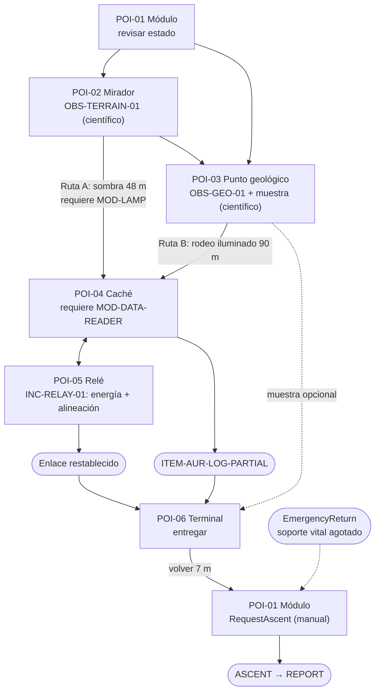

# Diseño de nivel de la demo: archivo lunar

Esquemática del mapa de superficie de `MIS-DEMO-01`. Usa solo nombres y valores de [parámetros](PARAMETROS-DEMO.md). Los parámetros que nacieron en este documento ya están en su tabla «Parámetros técnicos aceptados». El contenido propio del nivel (barrido, zonas, waypoints y capas) está en [§11](#11-contenido-del-nivel-y-parámetros). Comandos y eventos: [estructura de código](../../03-Arquitectura/ESTRUCTURA-CODIGO.md). Reglas: [mecánicas](MECANICAS.md) y [físicas](FISICAS.md). Representación temporal: [greybox](../../05-Arte/GREYBOX.md). Índice: [GDD de la demo](GDD-DEMO.md).

**No es un mapa Tiled ni un asset.** Es una especificación en texto. El mapa jugable se construye en la ventana autorizada ([AGENTS](../../../AGENTS.md)).

## 1. Intención del nivel y fantasía

**Fantasía:** «llego a un archivo lunar con el enlace averiado y lo encuentro leyendo el terreno». El jugador no sigue una flecha: mira desde un mirador, compara la sombra corta con la luz larga y decide según lo que eligió en el planificador.

Es un fragmento del [capítulo 2](../CAPITULOS/C2-BAJO-OTRO-CIELO.md) y reúne en un mapa compacto sus regiones C2-R02 (base), C2-R03 (llanura iluminada), C2-R04 (sector de sombra) y C2-R05 (borde de cráter y relé). **No completa AUR-E03 ni revela el destino.** El registro se recupera y se entrega, pero no se valida ([GDD](GDD-DEMO.md#objetivo-de-la-demo)).

Qué debe aprender el jugador sin pantallas de texto:

1. La sombra es una frontera. Sin `MOD-LAMP`, la simulación detiene al jugador en el borde y muestra un mensaje, sin causar daño.
2. La luz es más lenta, pero siempre existe. Todo lugar se alcanza sin lámpara.
3. Cada metro cuesta soporte vital (`minPerMeter` ≈ 0,2083 min de misión por metro). El HUD lo traduce en «tiempo de regreso».

**Fuente del relieve:** es **artístico declarado** (nivel F/S según [datos y realismo](../../04-Ciencia/DATOS-Y-REALISMO.md)). La luz rasante desde el oeste (`sunFromDirection` = W) y la forma de la sombra son ficción de diseño. No reproducen ningún lugar lunar ni ninguna hora solar. Si en la ventana autorizada hay tiempo, puede sustituirse por un recorte LOLA declarado ([PDS-LOLA](../../04-Ciencia/FUENTES.md)) **que conserve las longitudes de ruta de §3**. **Ahora no se descarga ni se procesa nada.**

## 2. Mapa en cuadrícula

Coordenadas lógicas en metros: el origen está en la esquina noroeste, `x` crece hacia el este y `y` hacia el sur. `tileSizeM` = 2 y el mapa tiene 56 × 44 celdas (112 × 88 m). La celda `(c, r)` cubre `x ∈ [2c, 2c+2)` e `y ∈ [2r, 2r+2)`. El bloque tiene exactamente 56 columnas y 44 filas, con un carácter por celda. La fila 0 es la primera línea.

Regla de columnas (no forma parte del bloque):

```text
0         1         2         3         4         5     
01234567890123456789012345678901234567890123456789012345
```

```text
########################################################
##############################CCCCCCC###################
#########################CCCCCCCCCCCCCCCC###############
#######################CCCssssssssssssssCCCC...........#
#####################CCCssssssssssssssssssCC...........#
####################CCsssssssssssssssssssssCC..........#
###################CCssssssssssss#ssssss....CCCC.......#
###################Cssssssssssssssssssss.....CCC.5.....#
##################CCssssssssssssssssssss.....CCC.......#
##################Csssssssssssssssssssss...............#
#################CCsssssss#sssssssssssss...............#
#################Cssssssssssssssssssssss.......w.......#
#################Cssssssssssssssssssssss...............#
#################Cssssssssssssssssssssss..........^^...#
#################Cssssssssssssssssss#sss.....CC........#
#################Cssssssssssssssssssssss.....CC........#
#################Cssssssssssssssssssssss.4...CC........#
#################Cssssssssss#sssssssssss.....C.........#
#################Cssssssssssssssssssssss.....C.........#
#################CCsssssssssssssssssssss.....C.........#
##################Csssssssssssssssssssss....CC.........#
###################Cssssssssssssssssssss...CC..........#
#................##CCsssssssssssssssssss..CC#......#s..#
#................#..CsssssssssssssssssssCC###..........#
#...............##^^^^sssssssssssssssCCCC####..........#
#...............#^^^^^CsssssssssssCCCC....###..........#
#...............#^^2^.CCCCCCCCCCCCC.......###....w.....#
#................^^^^.....CCC.............###..........#
#.........................................###..........#
#.........................................###..........#
#.....^^........#s........................###..........#
#......LLL......#s......#s................###..........#
#......LLL................................###.......^^.#
#......LLL....................3...........###..........#
#............##.........................^^###..........#
#.........1..##...........................^^^..........#
#...........................^^...............w.........#
#............6......................#ss................#
#......................................................#
#.............#ss......................................#
#..............................................#.......#
#......................................................#
#......................................................#
########################################################
```

### Leyenda

| Símbolo | Significado | Transitable sin lámpara | Con `MOD-LAMP` |
| --- | --- | --- | --- |
| `.` | Llano iluminado | Sí | Sí |
| `^` | Elevación transitable: mirador, rampa o montículo | Sí | Sí |
| `s` | Sombra | **No**: la simulación detiene al jugador en el borde | Sí; consume `lampW` |
| `#` | Roca, macizo o escarpe | No | No |
| `C` | Borde de cráter (cresta) | No | No |
| `L` | Casco del módulo | No | No |
| `1`–`6` | Ancla de `DEMO-POI-01`…`06` | Sí | Sí |
| `w` | Waypoint opcional (baliza de rastro, no bloquea) | Sí | Sí |

### Anclas de los lugares de interés

La celda de cada POI contiene su coordenada de [parámetros](PARAMETROS-DEMO.md#lugares-de-interés-coordenadas-lógicas-en-metros): `c = floor(x / 2)` y `r = floor(y / 2)`. Como las coordenadas son pares, el ancla queda en la esquina noroeste de su celda. Las cuatro celdas que tocan el ancla son transitables, así que el círculo de `playerRadiusM` cabe en ella.

| ID | Coordenada (m) | Celda (c, r) | Fila (texto) |
| --- | --- | --- | --- |
| DEMO-POI-01 | (20, 70) | (10, 35) | `#.........1..##…` |
| DEMO-POI-02 | (38, 52) | (19, 26) | `#...............#^^2^.…` |
| DEMO-POI-03 | (60, 66) | (30, 33) | `#......LLL....................3…` |
| DEMO-POI-04 | (82, 32) | (41, 16) | `#################Cssssssssssssssssssssss.4…` |
| DEMO-POI-05 | (98, 14) | (49, 7) | `###################Css…CCC.5.....#` |
| DEMO-POI-06 | (26, 74) | (13, 37) | `#............6…` |

### Lectura del mapa

- **Cráter (C2-R04):** ocupa el centro y el norte. El sol rasante llega desde el oeste, de modo que la cresta oeste proyecta sombra sobre el fondo (`s`). La pared interior este mira al sol y está iluminada; allí está la caché (`4`), a 2 m del borde de sombra (`x = 80`).
- **Mirador (C2-R03, `2`):** saliente elevado (`^`) del borde suroeste. Una rampa iluminada de unos 6,6 m baja hacia el noreste hasta el borde de sombra, donde empieza la ruta A.
- **Escarpe sureste (`###`, columnas 42–44, filas 23–34):** pared que mira al oeste y separa la llanura sur del altiplano este. Su extremo sur (paso `^^^`, fila 35) es el único paso iluminado. Por eso existe el rodeo.
- **Altiplano y corredor este (C2-R05):** franja iluminada de unos 20 m de ancho. Sube hasta el paso del borde este (filas 9–13) y el hombro exterior de la cresta donde está el relé (`5`).
- **Base (C2-R02):** módulo `L` (3 × 3 celdas) con la escotilla en el ancla `1`, y la terminal `6` a 7,2 m. Al norte de la terminal hay un grupo de rocas (`##`, columnas 13–14 y filas 34–35) que obliga a la ruta 02→06 a una curva suave.
- **Sombras de tutorial:** son manchas pequeñas al este de rocas, en las celdas (17, 30–31), (25, 31), (37–38, 37), (15–16, 39) y (52, 22). Enseñan la frontera de sombra sin cortar ninguna ruta.
- **Bordes del mapa:** son roca continua. No hay salida del mapa ni zonas sin colisión.

### Alturas visuales (solo render)

La simulación es plana en 2D lógico y la altura no cambia la velocidad ni el consumo. Los niveles usan `heightLevel` (0 / +1 / +2, con rampas) de [parámetros](PARAMETROS-DEMO.md). Se sigue la regla de [físicas](FISICAS.md) (§8): el nivel solo cambia en celdas de rampa y los bordes de meseta son bloqueantes. La altura desplaza el sprite `heightStepPx` (16 px) por nivel.

| Zona | Nivel visual |
| --- | --- |
| Celdas transitables (`.`, `s`, POI y `w`), incluidos el fondo del cráter y el altiplano este | 0 |
| Celda de POI-02 (cima del mirador) | +1 |
| `^` contiguas a POI-02 | Rampa: altura interpolada entre 0 y +1 hacia la cima |
| `^` restantes (montículos y paso sur del escarpe) | 0, con sprite de relieve bajo sin cambio de nivel |
| `C` (crestas) y rocas sueltas `#` | +1 (bloqueante) |
| Macizo noroeste, escarpe sureste y borde del mapa (`#`) | +2 (bloqueante) |
| Módulo `L` | +2 (bloqueante, con mástil) |

La profundidad del cráter se transmite con las crestas y la sombra, no con un nivel negativo. Así se cumple la restricción de §8.2 de físicas: ninguna celda elevada transitable (solo la cima del mirador) tiene delante una vecina más alta que no sea rampa.

## 3. Tabla de rutas

**Método de medida (sobre el bloque de §2):** camino más corto de ángulo libre (Theta*) entre las coordenadas exactas de los POI. Se comprueba la línea de visión cada 0,1 m con un cuadrado de ±`playerRadiusM` alrededor del punto: cada celda que toca debe ser transitable en el modo indicado. Como referencia se da también la ruta de 8 vecinos sin cortar esquinas (pasos de 2 m y 2,83 m). Los metros en sombra se integran a lo largo del camino. Las cifras salen de un script temporal fuera del repositorio. **Son medidas de la especificación, no del juego.** Fórmulas: s reales = m / `walkSpeedMps`; min de misión = m × `minPerMeter`.

| Tramo | Modo | Medida (m) | 8 vecinos (m) | Objetivo (m) | Desviación | m en sombra (objetivo) | s reales | min misión |
| --- | --- | --- | --- | --- | --- | --- | --- | --- |
| POI-01 → POI-02 | luz | 25,5 | 26,6 | 26 | −2,1 % | 0 (0) | 15,9 | 5,3 |
| POI-02 → POI-04 por la sombra | lámpara | 48,3 | 52,3 | 50 | −3,3 % | 39,5 (40) | 30,2 | 10,1 |
| POI-02 → POI-03 | luz | 26,1 | 27,8 | 26 | +0,3 % | 0 (0) | 16,3 | 5,4 |
| POI-03 → POI-04 por el rodeo iluminado | luz | 90,3 | 91,8 | 90 | +0,3 % | 0 (0) | 56,4 | 18,8 |
| POI-04 → POI-05 | luz | 24,9 | 24,6 | 25 | −0,2 % | 0 (0) | 15,6 | 5,2 |
| POI-03 → POI-06 | luz | 34,9 | 37,3 | 35 | −0,2 % | 0 (0) | 21,8 | 7,3 |
| POI-02 → POI-06 | luz | 27,3 | 28,1 | 28 | −2,5 % | 0 (0) | 17,1 | 5,7 |

Los siete tramos quedan dentro de ±10 % con los dos métodos. El de mayor desviación con 8 vecinos es POI-02 → POI-03, con +6,9 %.

En la ruta de sombra 02→04, el tramo iluminado va de 0 a 6,6 m (rampa del mirador), la sombra de 6,6 a 46,1 m y la luz de 46,1 a 48,3 m (ladera de la caché).

**Comprobaciones de diseño (W3 y alcanzabilidad):**

| Comprobación | Resultado medido | Criterio |
| --- | --- | --- |
| Camino más corto **solo por luz** POI-02 → POI-04 | 115,5 m, sin sombra | ≥ rodeo (81 m): sin lámpara no hay atajo |
| Solo por luz POI-01 → POI-04 / POI-06 → POI-04 | 130,4 m / 123,9 m | Cruzan el rodeo |
| Solo por luz POI-01 → POI-05 | 129,1 m | Alcanzable sin lámpara |
| Con lámpara POI-03 → POI-04 | 68,8 m (39,2 m en sombra), pasando por la rampa del mirador | Solo informativo |
| Componentes transitables solo por luz | 1 (1214 celdas) | Todo POI alcanzable sin lámpara y sin bolsas aisladas |
| Pasillos de una sola celda en luz | 0 | Evita atascos del jugador y de LUMA |
| Celda de sombra más alejada de la luz | 36,8 m, celda (22, 6), fondo noroeste | Informativo para el consumo de la lámpara |
| Regreso más largo a DEMO-POI-01, el punto de regreso (8 vecinos) | Luz 144,6 m (30,1 min); lámpara 116,4 m (24,2 min) | Base de las zonas de aviso (§9) |

**Recorridos de referencia** (comparar con las [configuraciones](PARAMETROS-DEMO.md#configuraciones-de-referencia-calculadas)):

| Configuración | Secuencia | Medido | PARAMETROS | Sombra | Min caminando |
| --- | --- | --- | --- | --- | --- |
| A · Sombra rápida | 01→02→04 (sombra)→05→04→02 (sombra)→03→06 | 232,9 m | 237 m (−1,7 %) | 79,0 m (80) | 48,5 (49,4) |
| B · Luz y paciencia | 01→02→03→04 (rodeo)→05→04→03 (rodeo)→06 | 316,9 m | 317 m (0,0 %) | 0 | 66,0 (66,0) |

En A, la lámpara gasta 79,0 m / 1,6 × 20 s ≈ 16,5 min × `lampW` 80 W ≈ 21,9 Wh. PARAMETROS da 22,2 Wh.

Los recorridos de PARAMETROS terminan en POI-06. Para ascender hay que volver a POI-01 y pedir `RequestAscent`: son 7,2 m más (4,5 s reales, 1,5 min de misión), que §8 muestra en una fila aparte.

## 4. Fichas de los lugares de interés

Radios: `interactRadiusM` = 1,5 m (E) y `scanRadiusM` = 3,0 m (R). Las reacciones de LUMA están definidas en [mecánicas](MECANICAS.md). Aquí solo se fija **dónde y cuándo** se disparan. Los autosaves de hito siguen el [GDD](GDD-DEMO.md#puntos-de-control-y-guardado) y el [guardado](../../03-Arquitectura/GUARDADO.md): sin recompensas duplicadas.

### DEMO-POI-01 · Módulo y refugio · (20, 70)

| Campo | Contenido |
| --- | --- |
| Propósito | Inicio y fin de la superficie y **punto de regreso** ([parámetros](PARAMETROS-DEMO.md)). `LifeSupportWarning` y `EmergencyReturn` miden la distancia hasta aquí, y `RequestAscent` solo se acepta a `interactRadiusM` o menos de este punto. |
| Pregunta | ¿Con qué he salido y cuánto puedo alejarme? |
| Acción | E en la escotilla (`Interact`): «Revisar estado» abre un panel que pausa y cuesta 0 min (recursos reales frente a la estimación, ruta de regreso y protección de LUMA). Se cierra con `ClosePanel`. E «Despegar» envía `RequestAscent`; si el objetivo principal no está completo, pide confirmación (`confirmed` = true) porque será un aborto. **El ascenso siempre es manual:** ni la entrega ni ningún otro hito lo inician. Las acciones las define [mecánicas](MECANICAS.md). |
| Lectura visual | Silueta más alta de la base: casco de 3 × 3 celdas con mástil. La escotilla tiene un marco luminoso hacia el sureste. Se ve desde el mirador, a 25,5 m. |
| Radio | `interactRadiusM` en el ancla de la escotilla. |
| LUMA | `LUMA-R-LANDING` se dispara con el evento `Landed` (sin zona). LUMA sale del módulo con su protección (`MOD-LUMA-SHIELD`). |
| Aprende | Mover, interactuar y leer el soporte vital (§7). Volver aquí es la decisión que cierra la superficie. |
| Autosave | `CP-SURFACE` con `Landed`. Revisar estado no crea hito. |

### DEMO-POI-02 · Mirador del terreno · (38, 52)

| Campo | Contenido |
| --- | --- |
| Propósito | Elegir el acceso al archivo: la sombra corta o la luz larga. |
| Pregunta | ¿Puedo cruzar la sombra con lo que traje? Si no, ¿por dónde rodeo? |
| Acción | E «Observar» (`observeMin` = 2, 6 s reales) registra `OBS-TERRAIN-01` y hace el barrido de cámara de §6. También anota en el mapa las rutas A y B, con metros, metros en sombra y minutos estimados con el equipo llevado. |
| Lectura visual | Punto transitable más alto del sur (`^`, +1), con un poste de observación y un flanco de roca al oeste. Desde la llanura se distingue como la única elevación pegada al cráter oscuro. |
| Radio | `interactRadiusM` en el ancla. |
| LUMA | `LUMA-R-VIEWPOINT` se dispara al completar la observación. `LUMA-R-SHADOW` es un evento de [mecánicas](MECANICAS.md): variante A en el primer bloqueo de sombra y variante B en la primera entrada con lámpara. El nivel hace que ese primer contacto ocurra casi siempre al final de la rampa del mirador, en la zona `TRG-SHADOW-RAMP`: celdas de rampa (20, 24), (21, 24) y (21, 25), y sus celdas de sombra contiguas (21, 23), (22, 23) y (22, 24). La zona solo sirve al tutorial; la reacción no depende de ella. |
| Aprende | El terreno da la información. Sin lámpara, la rampa termina en un borde que detiene al jugador con el mensaje de sombra de [mecánicas](MECANICAS.md) (§6.3), y el mapa ya muestra el rodeo. |
| Autosave | Hito tras `ObservationRecorded` (`OBS-TERRAIN-01`). |

### DEMO-POI-03 · Punto geológico · (60, 66)

| Campo | Contenido |
| --- | --- |
| Propósito | Objetivo científico: contrastar la interpretación del terreno con una medida. |
| Pregunta | ¿Este material procede del cráter? |
| Acción | R «Escanear» (comando `Scan`; `scanMin` = 3, consume `scannerW`; requiere `MOD-SCANNER`) registra `OBS-GEO-01`. E «Tomar muestra» (`Interact`; `sampleMin` = 3, sin requisito de equipo según [mecánicas](MECANICAS.md)) da `ITEM-SAMPLE-REGOLITH-01` (`SampleCollected`). Las dos acciones están en el mismo punto. |
| Lectura visual | Afloramiento de bloques de eyección con una estaca de muestreo. Los montículos `^^` a 6 m al sur y a 20 m al este sirven de referencia. Está en el cruce natural de las rutas 02→03, 03→06 y el comienzo del rodeo. |
| Radio | `scanRadiusM` para R e `interactRadiusM` para E. Sin escáner, el aviso de R aparece **bloqueado** con el motivo. |
| LUMA | `LUMA-R-SAMPLE` se dispara con `SampleCollected`. |
| Aprende | El escaneo es opcional para el objetivo principal pero necesario para el científico. El informe lo explica (W2). |
| Autosave | Hitos tras `ObservationRecorded` (`OBS-GEO-01`) y `SampleCollected`. |

### DEMO-POI-04 · Caché protegida · (82, 32)

| Campo | Contenido |
| --- | --- |
| Propósito | Recuperar el registro parcial de Aurora. |
| Pregunta | ¿Llego por la sombra o por la luz, y con qué reserva vuelvo? |
| Acción | E «Recuperar registro» (`cacheRetrieveMin` = 6; requiere `MOD-DATA-READER`, garantizado por V3) da `ITEM-AUR-LOG-PARTIAL` (`ItemRecovered`). El diario lo muestra como **recogido, pendiente de autenticación**: no se valida AUR-E03. |
| Lectura visual | Contenedor bajo con baliza, en la ladera este iluminada y a 2 m del borde de sombra. Desde el mirador se ve como un punto blanco al otro lado del fondo oscuro. Es el landmark que hace legible la ruta A. |
| Radio | `interactRadiusM`. |
| LUMA | `LUMA-R-CACHE` se dispara con `ItemRecovered`. LUMA reconoce el contenedor de la expedición de la hermana. **No conoce ni revela su contenido** ([LUMA](../LUMA.md)). |
| Aprende | Recoger no es validar. |
| Autosave | Hito tras `ItemRecovered`. |

### DEMO-POI-05 · Relé · (98, 14)

| Campo | Contenido |
| --- | --- |
| Propósito | Resolver `INC-RELAY-01` y restablecer el enlace del archivo. |
| Pregunta | ¿Con qué energía y con qué alineación lo arreglo? |
| Acción | Hay dos pasos en el panel de reparación, que se abre con `Interact`. **Energía:** batería (`relayBatteryMin` = 1) o panel solar (`relaySolarDeployMin` = 2 más `relaySolarChargeMin` = 10 de carga; el panel genera porque el lugar está iluminado). **Alineación:** con kit (`relayAlignToolkitMin` = 5) o a mano: se busca la señal con `RotateRelayDial` o `AutoSweepRelay` (reloj congelado con el panel abierto), se confirma con `ConfirmRelayAlignment` y siguen `relayAlignManualMin` = 15. La carga solar y la alineación se solapan. Duración: panel + kit, 12 min; panel a mano, 17; batería + kit, 6; batería a mano, 16. |
| Lectura visual | Mástil con plato en el hombro exterior de la cresta noreste. Es el objeto más alto del mapa y se recorta contra el fondo de espacio, junto al borde noreste. Se ve desde el mirador. |
| Radio | `interactRadiusM`. |
| LUMA | `LUMA-R-RELAY` se dispara con `LinkRestored`. |
| Aprende | Una decisión del planificador (batería o panel, kit o no) se convierte aquí en minutos visibles. El kit ahorra 5 min con panel y 10 con batería (W5 avisa si falta). |
| Autosave | Hitos tras `RelayPowered`, `RelayAligned` y `LinkRestored`. |

### DEMO-POI-06 · Terminal de retorno · (26, 74)

| Campo | Contenido |
| --- | --- |
| Propósito | Entregar el registro y la muestra, en el orden que el jugador quiera, para completar el objetivo principal. La misión se cierra después, al ascender desde POI-01. |
| Pregunta | ¿Tengo lo necesario para entregar? |
| Acción | E «Entregar» (`Interact`; `deliverMin` = 2 por acción) emite un `ItemDelivered` por objeto. El registro requiere `LinkRestored`; la muestra no requiere nada. Si falta el enlace, el aviso muestra **bloqueado** y el motivo. **Entregar no inicia el ascenso:** el jugador vuelve a POI-01 (7,2 m) y lo pide con `RequestAscent`. |
| Lectura visual | Consola baja con antena corta y pantalla, junto al módulo (7,2 m). Las rocas del norte la separan visualmente de la llanura. Todas las rutas de regreso convergen aquí, a 7,2 m del punto de regreso. |
| Radio | `interactRadiusM`. |
| LUMA | `LUMA-R-DELIVER` se dispara con el `ItemDelivered` del registro. Termina con la pista visible prevista en el [GDD](GDD-DEMO.md), sin revelar el destino. |
| Aprende | El informe vincula cada resultado con su decisión. |
| Autosave | Hito tras cada `ItemDelivered`. |

`LUMA-R-LOWLS` no tiene lugar fijo. Se dispara con `LifeSupportWarning`, la primera vez que se cumple la condición de aviso (§9).

## 5. Ruta crítica y alternativas



- **Objetivo principal:** POI-04 (registro), POI-05 (relé) y POI-06 (entrega). POI-02 y POI-03 son opcionales para cerrarlo. POI-03 es necesario para el objetivo científico.
- **Orden libre:** POI-04 y POI-05 pueden hacerse en cualquier orden porque el paso del borde este conecta los dos. La observación y el punto geológico pueden hacerse a la ida o a la vuelta. Solo la entrega exige el registro y el relé restablecido.
- **Ruta A (sombra, `MOD-LAMP`):** 01→02→04→05→04→02→03→06. Es más corta y gasta energía de equipo.
- **Ruta B (luz):** 01→02→03→04→05→04→03→06. Es más larga y no necesita lámpara.
- **Mixta:** ida por la sombra y vuelta por el rodeo, o al revés. Es válida y el informe la atribuye por tramos.
- **Ascenso:** siempre manual, con `RequestAscent` en POI-01. Entregar en POI-06 no lo inicia, así que el jugador puede entregar el registro y la muestra en el orden que quiera. Sin objetivo principal completo, pide confirmación porque será un aborto. Si el soporte vital se agota, `EmergencyReturn` lleva al astronauta y a LUMA a POI-01 y de ahí a `ASCENT`.

## 6. Líneas de visión y orientación

**Proyección:** `X = (x − y) × 16 px/m` e `Y = (x + y) × 8 px/m` (rombo 64 × 32 por celda de 2 m). Lo que tiene mayor `x + y` se dibuja delante. Con esta proyección, el norte del mapa queda arriba a la derecha de la pantalla y el oeste arriba a la izquierda. La luz llega desde arriba a la izquierda y las sombras caen hacia abajo a la derecha.

**Desde el mirador:** con zoom 1, la vista abarca unos ±21,2 m en la diagonal horizontal ([físicas](FISICAS.md) §8). La caché queda fuera de cuadro, a unos 1024 px a la derecha. Físicas solo admite zoom entero (`cameraZoomLevels` = {1, 2}), así que «Observar» no aleja la cámara. Durante los 6 s reales de `observeMin`, hace un **barrido** de zoom 1 por `viewpointPanPathM` (§11), que ejecuta SurfaceScene, la escena propietaria de la cámara: mirador (38, 52) → caché (82, 32) → relé (98, 14) → paso sur del escarpe (88, 72) → mirador. Al terminar, el mapa (`MAP`) muestra las dos rutas anotadas. Con movimiento reducido no hay barrido: se abre directamente la superposición `MAP` con las rutas. Durante el barrido el jugador ve:

- **Ruta A:** la rampa iluminada que baja al fondo oscuro y, al otro lado, la baliza blanca de la caché sobre la ladera iluminada.
- **Ruta B:** la llanura hacia el sureste, la pared larga del escarpe, su paso sur (`DEMO-WP-01`) y el corredor que sube hacia el paso del borde este (`DEMO-WP-02`, `DEMO-WP-03`).
- **Relé en el horizonte:** el mástil de POI-05 junto al borde noreste del mapa, recortado contra el fondo de espacio.

**Landmarks** (de mayor a menor altura visual): mástil del relé (noreste), casco y mástil del módulo (suroeste), macizo noroeste (fondo de cuadro, nunca tapa al jugador), escarpe sureste (pared continua), poste del mirador, baliza de la caché y estaca del punto geológico.

**Migas de pan:** son waypoints `w` opcionales que no bloquean. `DEMO-WP-01` está en la celda (45, 36), junto al paso sur del escarpe. `DEMO-WP-02` está en (49, 26), a mitad del corredor. `DEMO-WP-03` está en (47, 11), en el paso del borde este. Son balizas de rastro visibles a unos 20 m. Tras la observación, el mapa (M) dibuja las rutas A y B y la posición del jugador. Las huellas, si se añaden, son solo de render.

**El borde de sombra como información:** la forma de la sombra indica de dónde viene el sol. Las paredes que miran al oeste (ladera de la caché y cara del escarpe) están iluminadas; las que miran al este no. El borde se dibuja como una línea continua (§9 y [greybox](../../05-Arte/GREYBOX.md)). Sin lámpara es una frontera y el jugador lo sabe antes de tocarla. Con lámpara, el HUD muestra el consumo mientras se pisa la sombra.

## 7. Tutorial integrado

Las indicaciones son contextuales, de ocho palabras como mucho, y desaparecen al cumplirse. No hay pantallas de texto largas. Todas las indicaciones se pueden volver a consultar con F1.

| Habilidad | Dónde | Disparador | Indicación | Se cumple cuando |
| --- | --- | --- | --- | --- |
| Mover | Ancla de POI-01 | Entrar en `SURFACE` | «WASD para moverte» | El jugador recorre 2 m |
| Interactuar | Escotilla de POI-01 | A `interactRadiusM` o menos | «E · Revisar estado» | Revisión abierta |
| Leer soporte vital | Salida de la base | Primera vez a más de `poiApproachRadiusM` de POI-01 | Se resalta la barra de soporte vital con la marca «tiempo de regreso» | Pasan 5 s o el jugador abre el mapa |
| Reconocer sombra | Sombra de tutorial (17, 30–31), a unos 4 m de la ruta 01→02 | Entra en pantalla | Etiqueta en el mundo: «Sombra: requiere lámpara» | El jugador la pasa |
| Frontera de sombra | Rampa del mirador | Contacto con `TRG-SHADOW-RAMP` | Sin lámpara: mensaje de sombra de [mecánicas](MECANICAS.md) (§6.3) y `LUMA-R-SHADOW` (A). Con lámpara: «La lámpara consume energía en sombra» y `LUMA-R-SHADOW` (B) | Primer contacto |
| Observar y usar el mapa | POI-02 | Fin de «Observar» | «M · Ver rutas en el mapa» | El jugador abre el mapa |
| Escanear | POI-03 | A `scanRadiusM` o menos | «R · Escanear», o bloqueado «Requiere espectrómetro» | Escaneo hecho o el jugador se aleja |
| Diario | POI-04 | Registro recogido | «Tab · Diario» | El jugador abre el diario |

## 8. Ritmo minuto a minuto

**Duración real.** La simulación de superficie dura unos **4–5 min reales**: 4:06 en A y 4:47 en B, contando la vuelta a POI-01. Los **8–12 min reales** del [GDD](GDD-DEMO.md#recorrido-1525-min) suman lectura, decisiones, desvíos y pausas. Es una **estimación por validar con jugadores**, no un resultado medido.

**Nominal:** solo simulación, sin desvíos ni pausas, con las longitudes medidas en §3 y las duraciones de [parámetros](PARAMETROS-DEMO.md#superficie-soporte-vital-energía-y-actividades). Hasta la entrega reproduce PARAMETROS:

- A: 80,5 min de misión (81,4 en PARAMETROS), el 67,1 % de 120 (67,8 %).
- B: 94,0 min, el 52,2 % de 180.

La última fila suma la vuelta a POI-01 y `RequestAscent` (+7,2 m, +1,5 min), que PARAMETROS no cuenta.

**Típico** (estimación de diseño):

- +30 % de recorrido por orientación y desvíos.
- 45 s de inactividad con la simulación activa: 15 s en POI-01, 15 s en POI-02 y 15 s en POI-05.
- Pausas que no avanzan la simulación: 45 s en revisar estado, 30 s en la observación y el mapa, 30 s en la lectura del registro, 20 s en cada uno de estos (panel del relé, ficha científica y entrega) y 10 s en la confirmación del ascenso.

El umbral de aviso se evalúa con la distancia de §3 a POI-01 (8 vecinos): `LifeSupportWarning` si el soporte restante es menor que el regreso × `lifeSupportWarnFactor` + `lifeSupportWarnBufferMin`.

### Configuración A · Sombra rápida (`lifeSupportBaseMin` = 120 min)

| Paso | s simulados | t nominal | min misión (nom.) | Soporte restante (nom.) | Pausa (s) | t típico | min misión (típ.) |
| --- | --- | --- | --- | --- | --- | --- | --- |
| Llegada, `LUMA-R-LANDING`, revisar estado (01) | 0 | 0:00 | 0,0 | 120,0 | 45 | 1:00 | 5,0 |
| 01→02 | 15,9 | 0:16 | 5,3 | 114,7 | 0 | 1:21 | 11,9 |
| Observar (02) | 6,0 | 0:22 | 7,3 | 112,7 | 30 | 2:12 | 18,9 |
| 02→04 por la sombra | 30,2 | 0:52 | 17,4 | 102,6 | 0 | 2:51 | 32,0 |
| Recuperar registro (04) | 18,0 | 1:10 | 23,4 | 96,6 | 30 | 3:39 | 38,0 |
| 04→05 | 15,6 | 1:26 | 28,6 | 91,4 | 0 | 3:59 | 44,7 |
| Relé: batería + alineación manual (1 + 15) (05) | 48,0 | 2:14 | 44,6 | 75,4 | 20 | 5:22 | 65,7 |
| 05→04 | 15,6 | 2:29 | 49,8 | 70,2 | 0 | 5:42 | 72,5 |
| 04→02 por la sombra | 30,2 | 2:59 | 59,8 | 60,2 | 0 | 6:22 | 85,6 |
| 02→03 | 16,3 | 3:16 | 65,2 | 54,8 | 0 | 6:43 | 92,6 |
| Escanear + muestra (03) | 18,0 | 3:34 | 71,2 | 48,8 | 20 | 7:21 | 98,6 |
| 03→06 | 21,8 | 3:56 | 78,5 | 41,5 | 0 | 7:49 | 108,1 |
| Entregar (06) | 6,0 | 4:02 | 80,5 (67,1 %) | 39,5 | 20 | 8:15 | 110,1 |
| 06→01 y `RequestAscent` (01) | 4,5 | **4:06** | 82,0 | 38,0 | 10 | **8:31** | 112,0 (93 %) |

### Configuración B · Luz y paciencia (120 + `o2ReserveMin` 60 = 180 min)

| Paso | s simulados | t nominal | min misión (nom.) | Soporte restante (nom.) | Pausa (s) | t típico | min misión (típ.) |
| --- | --- | --- | --- | --- | --- | --- | --- |
| Llegada, `LUMA-R-LANDING`, revisar estado (01) | 0 | 0:00 | 0,0 | 180,0 | 45 | 1:00 | 5,0 |
| 01→02 | 15,9 | 0:16 | 5,3 | 174,7 | 0 | 1:21 | 11,9 |
| Observar (02) | 6,0 | 0:22 | 7,3 | 172,7 | 30 | 2:12 | 18,9 |
| 02→03 | 16,3 | 0:38 | 12,8 | 167,2 | 0 | 2:33 | 26,0 |
| Escanear + muestra (03) | 18,0 | 0:56 | 18,8 | 161,2 | 20 | 3:11 | 32,0 |
| 03→04 por el rodeo | 56,4 | 1:53 | 37,6 | 142,4 | 0 | 4:24 | 56,4 |
| Recuperar registro (04) | 18,0 | 2:11 | 43,6 | 136,4 | 30 | 5:12 | 62,4 |
| 04→05 | 15,6 | 2:26 | 48,8 | 131,2 | 0 | 5:33 | 69,2 |
| Relé: panel + kit (2 + max(10, 5)) (05) | 36,0 | 3:02 | 60,8 | 119,2 | 20 | 6:44 | 86,2 |
| 05→04 | 15,6 | 3:18 | 65,9 | 114,1 | 0 | 7:04 | 92,9 |
| 04→03 por el rodeo | 56,4 | 4:14 | 84,8 | 95,2 | 0 | 8:17 | 117,4 |
| 03→06 | 21,8 | 4:36 | 92,0 | 88,0 | 0 | 8:45 | 126,8 |
| Entregar (06) | 6,0 | 4:42 | 94,0 (52,2 %) | 86,0 | 20 | 9:11 | 128,8 |
| 06→01 y `RequestAscent` (01) | 4,5 | **4:47** | 95,5 | 84,5 | 10 | **9:27** | 130,8 (73 %) |

### Configuración B sin `MOD-O2-RESERVE` (120 min)

Los pasos son los de B; solo cambia la capacidad.

| Caso | Hasta la entrega | Con la vuelta a POI-01 | Aviso y regreso |
| --- | --- | --- | --- |
| Nominal | 94,0 min, el **78,4 %** (W4, como en PARAMETROS) | 95,5 min (79,6 %) | Sin aviso. Quedan 24,5 min. |
| Típico | — | — | `LifeSupportWarning` y `LUMA-R-LOWLS` al terminar el relé (quedan 33,8 min frente a un umbral de 39,1). Si sigue la ruta, el soporte se agota entre POI-03 y POI-06 y salta `EmergencyReturn` antes de entregar. |

**Lectura:**

- En el caso típico, la simulación pasa de 4:06 a 8:31 en A y de 4:47 a 9:27 en B. El resto es estimación de lectura, decisiones, desvíos y pausas.
- Con 120 min, A típico termina con unos 8 min de margen (93 %), sin aviso.
- B sin reserva convierte W4 en una consecuencia visible: aviso en el relé y regreso de emergencia si el jugador no ajusta la ruta. Es la lección de PARAMETROS: sin atajo por la sombra hace falta reserva de soporte vital.

## 9. Riesgos de diseño y soluciones

| Riesgo | Dónde | Solución |
| --- | --- | --- |
| Perderse | Corredor este y fondo del cráter | Landmarks altos y únicos (relé y módulo), waypoints `DEMO-WP-01…03`, rutas dibujadas en el mapa tras observar y marca de regreso en el HUD. El cráter está cerrado al norte y al oeste: no hay callejones. |
| Quedarse sin soporte lejos | Paso del borde este, relé y fondo noroeste del cráter | El aviso es dinámico: se dispara cuando el soporte restante es menor que el tiempo de regreso × `lifeSupportWarnFactor` + `lifeSupportWarnBufferMin`, y el regreso se calcula por el camino más corto con el equipo llevado. Zonas de prueba según la distancia al módulo: cerca (< 40 m: base, mirador y punto geológico), media (40–90 m: llanura este y fondo del cráter cercano) y lejos (> 90 m: corredor, caché por el rodeo y relé). El peor caso con luz es 144,6 m, unos 30,1 min, con aviso por debajo de 42,6 min restantes. Con lámpara es 116,4 m, unos 24,2 min, con aviso por debajo de 35,3 min. Desde el relé, el campo de distancias de [físicas](FISICAS.md) (8 vecinos) da 131,0 m sin lámpara y 103,5 m con lámpara. Mecánicas, en su ejemplo, usa 129,1 m sin lámpara (ángulo libre, §3) y 101 m con lámpara (tramos de PARAMETROS). Las dos medidas difieren menos de un 3 %; las cifras de §8 usan las de 8 vecinos. `LUMA-R-LOWLS` acompaña el primer aviso. Si el soporte se agota, `EmergencyReturn` lleva al astronauta y a LUMA a POI-01 por los waypoints del mapa ([GDD](GDD-DEMO.md#victoria-fallo-y-recuperación)). Con la capacidad nueva, en el caso típico de §8 B sin `MOD-O2-RESERVE` recibe el aviso al reparar el relé y agota el soporte antes de entregar. A queda con unos 8 min de margen. |
| Atascos de LUMA | Rampa del mirador, paso sur del escarpe y paso del borde este | No hay pasillos de una celda en luz (§3). LUMA usa la misma transitabilidad que el jugador: solo entra en sombra si el jugador lleva lámpara y va con él. Si queda a más de `lumaRegroupDistM` o atascada durante `lumaStuckS`, se reubica junto al jugador con un fundido (`lumaRegroupFadeS`). Con zoom 1 no puede hacerse fuera de cámara. `lumaRadiusM` no bloquea al jugador. **LUMA no tiene salud en la demo**: la sombra no le hace daño. |
| Oclusión por rocas altas | Escarpe sureste (al caminar por su pie oeste), casco del módulo (al pasar por su norte), rocas de las celdas (16, 30–31), (13–14, 34–35) y (24, 31), y cresta sur del cráter (fondo del cráter cerca de la fila 25) | Todo sprite bloqueante que se dibuja delante (mayor `x + y`) y se solapa en pantalla con el jugador o con LUMA pasa a `occluderAlpha` (0,4) durante `occluderFadeS` (0,15 s), valores de [físicas](FISICAS.md) §8 aceptados en [parámetros](PARAMETROS-DEMO.md), y deja ver la silueta del personaje. Es una regla única para todo el mapa ([guía visual](../../05-Arte/GUIA-VISUAL.md)). Los POI no se colocan detrás de oclusores. |
| Sombra y luz ilegibles en grises | Toda la sombra | La sombra lleva un patrón rayado además de ser más oscura. El borde se dibuja como línea: continua gruesa si no se puede cruzar y discontinua si se lleva lámpara. Se lee en monocromo ([greybox](../../05-Arte/GREYBOX.md)). |
| El jugador cree que la sombra hace daño | Rampa del mirador | El mensaje dice que la simulación lo detiene y no le hace daño. El HUD no muestra ninguna pérdida. |
| El rodeo parece arbitrario | Escarpe | El escarpe forma parte del altiplano (alto, continuo, iluminado de cara) y se ve entero desde el mirador. El paso sur es su única salida visible. |

## 10. Casos de prueba de nivel

Pueden comprobarse con una validación de contenido (Vitest sobre el JSON de Tiled exportado) o con Playwright sobre la demo. **Ninguno se ha ejecutado**, porque todavía no hay juego. Las cifras esperadas salen de §3.

| ID | Tipo | Comprobación | Esperado |
| --- | --- | --- | --- |
| T-NIV-01 | Contenido | Dimensiones y alfabeto del mapa | 56 × 44 celdas. Solo los símbolos de la leyenda. Borde de roca continuo. |
| T-NIV-02 | Contenido | Los POI están en la celda correcta | La celda de cada POI es `(floor(x/2), floor(y/2))` según PARAMETROS, y el cuadrado de ±`playerRadiusM` alrededor del ancla es transitable. |
| T-NIV-03 | Contenido | Alcanzabilidad sin lámpara | Todas las celdas transitables con luz forman un solo componente que contiene los seis POI. |
| T-NIV-04 | Contenido | Longitudes de ruta | Los siete tramos de PARAMETROS quedan dentro de ±10 % con el método de §3. |
| T-NIV-05 | Contenido | Sombra de la ruta A | Con lámpara, 02→04 mide 45–55 m, de los que 36–44 m son sombra. |
| T-NIV-06 | Contenido | Sin atajo iluminado (W3) | Solo por luz, 02→04 ≥ 81 m y 03→04 dentro de [81, 99] m. Ningún camino solo por luz cruza celdas `s`. |
| T-NIV-07 | Playwright | Frontera de sombra sin lámpara | Sin `MOD-LAMP`, avanzar desde POI-02 hacia POI-04 deja al jugador en luz, en el borde. Con `SetMoveInput` hacia la sombra, se publica `blockedBy = shadow`, aparece el mensaje de sombra de mecánicas y no hay daño ni cambio de recursos. |
| T-NIV-08 | Playwright | Consumo de la lámpara | Al cruzar 02→04 con lámpara, la energía baja unos `lampW` × tiempo en sombra (≈ 11,0 Wh, ±10 %), y no baja nada en los tramos iluminados. |
| T-NIV-09 | Contenido | Sin pasillos estrechos | Ninguna celda iluminada tiene bloqueadas a la vez las vecinas izquierda y derecha, o arriba y abajo. |
| T-NIV-10 | Contenido | Sin zonas atrapantes | Desde toda celda transitable se puede volver a POI-01 con el mismo equipo. Desde toda celda de sombra hay luz a 40 m o menos (medido: 36,8 m). |
| T-NIV-11 | Contenido | Recorridos de referencia | A dentro de 237 m ±5 % con 80 m ±10 % de sombra. B dentro de 317 m ±5 %. |
| T-NIV-12 | Playwright | LUMA en las rampas y los pasos | Un recorrido automático A y otro B (`walkTo` por POI y waypoints) no activan nunca la reubicación de LUMA (`lumaRegroupDistM`, `lumaStuckS`). |
| T-NIV-13 | Playwright | Oclusión | Al caminar por el pie oeste del escarpe y por el norte del módulo, el oclusor se dibuja con `occluderAlpha` y el jugador sigue visible. |
| T-NIV-14 | Playwright | Radios de interacción | El aviso E aparece a `interactRadiusM` o menos y desaparece más allá. El aviso R, a `scanRadiusM` o menos. |
| T-NIV-15 | Playwright | Observar desde el mirador | Registra `OBS-TERRAIN-01` y ejecuta el barrido de §6, en el que POI-04 y POI-05 entran en la vista con zoom 1. El mapa muestra las rutas A y B. Con movimiento reducido no hay barrido y se abre `MAP`. |
| T-NIV-16 | Playwright | Dependencias de entrega | En POI-06, sin `LinkRestored` la entrega del registro aparece bloqueada con el motivo. Con enlace, cada `ItemDelivered` se emite una sola vez, también al recargar el hito. Entregar **no** cambia el modo a `ASCENT`. |
| T-NIV-17 | Contenido | Waypoints | Los `w` son transitables, no bloquean y no están en sombra. |
| T-NIV-18 | Playwright | Ascenso manual en POI-01 | `RequestAscent` se rechaza (`lastRejection`) a más de `interactRadiusM` de POI-01. Con el objetivo principal incompleto exige `confirmed` = true. Solo entonces pasa a `ASCENT`. |
| T-NIV-19 | Playwright | Regreso de emergencia | Con el soporte vital a 0 en POI-05 y sin lámpara, `EmergencyReturn` lleva al astronauta y a LUMA a POI-01 por `DEMO-WP-03` → `DEMO-WP-02` → `DEMO-WP-01` sin atravesar sombra, y después pasa a `ASCENT`. |

## 11. Contenido del nivel y parámetros

**Parámetros que nacieron en este documento y ya están aceptados en [parámetros](PARAMETROS-DEMO.md#parámetros-técnicos-aceptados-de-otras-esquemáticas):** `sunFromDirection` (W), `poiApproachRadiusM` (6 m) y `heightLevel` (0 / +1 / +2, con rampas). Aquí solo se citan. Del greybox: `lampVisualRadiusM`, `uiMinFontPx`, `blinkHz`, `outlinePx` y `shadowHatchSpacingPx`. Se usan además `cameraZoomLevels`, `occluderAlpha`, `occluderFadeS`, `lumaStuckS` y `lumaRegroupFadeS`, de físicas.

**Contenido de `MAP-DEMO-01`** (datos del mapa, no parámetros de balance):

| Elemento | Valor | Uso |
| --- | --- | --- |
| viewpointPanPathM | (38, 52) → (82, 32) → (98, 14) → (88, 72) → (38, 52) m | Barrido de cámara con zoom 1 durante `observeMin` (6 s reales) en POI-02. Sin barrido con movimiento reducido. |
| TRG-SHADOW-RAMP | Celdas (20, 24), (21, 24), (21, 25), (21, 23), (22, 23), (22, 24) | Zona del tutorial de frontera. `LUMA-R-SHADOW` se dispara por evento ([mecánicas](MECANICAS.md)). |
| DEMO-WP-01…03 | Celdas (45, 36), (49, 26), (47, 11) | Waypoints del rodeo: migas de pan, `walkTo` en pruebas y ruta de `EmergencyReturn` ([estructura de código](../../03-Arquitectura/ESTRUCTURA-CODIGO.md)). |
| Capas Tiled | `ground`, `light`, `collision`, `poi`, `trigger`, `decor`, `occluder` | La exportación se convierte en el `MapDefinition` de estructura de código. Cada celda lleva `height`, `blocked`, `shadow` y `terrain` (clave visual: `lit`, `shadow`, `rock`, `rim`, `elevation`). Las reglas leen `blocked` y `shadow`, no los índices de tile. |
