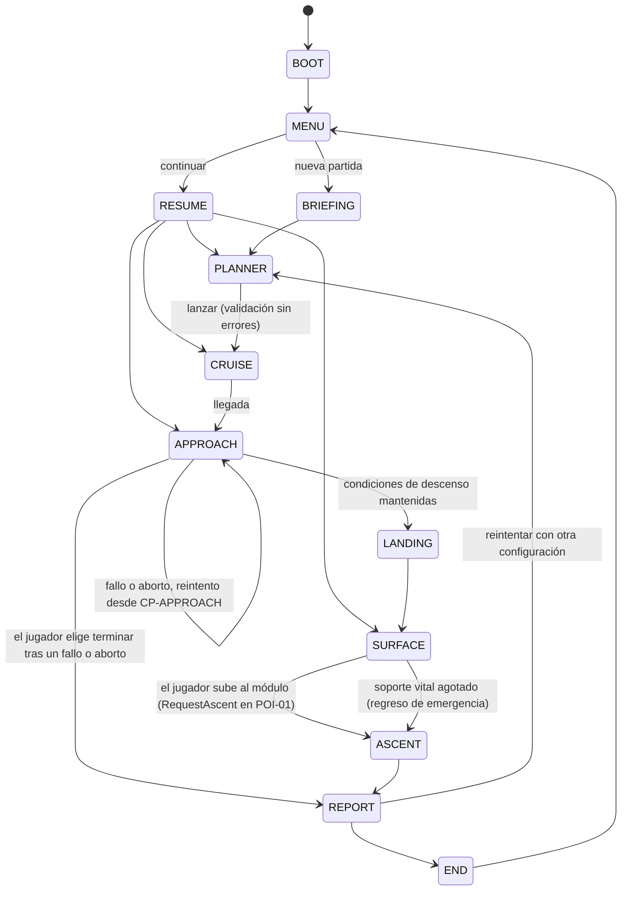

# GDD de la demo: «Una voz en el archivo»

Esquemática principal de la demo de hackathon. Es el índice de las demás esquemáticas y fija la máquina de estados, los IDs y el alcance. **No hay código.** La demo se programa en la ventana autorizada siguiendo la [orquestación de la hackathon](../../06-Produccion/ORQUESTACION-HACKATHON.md) ([ADR 003](../../03-Arquitectura/ADR/ADR-003.md)).

| Esquemática | Contenido |
| --- | --- |
| [Parámetros](PARAMETROS-DEMO.md) | Fuente única de valores, unidades y configuraciones de referencia. |
| [Mecánicas](MECANICAS.md) | Reglas de recursos, planificador, superficie, incidencia, LUMA e informe. |
| [Físicas](FISICAS.md) | Bucle de simulación, vuelo local, crucero, movimiento, colisiones y proyección. |
| [Diseño de nivel](DISENO-DE-NIVEL.md) | Mapa lunar compacto, seis lugares, rutas y ritmo. |
| [Greybox](../../05-Arte/GREYBOX.md) | Representación temporal en grises y blanco. |
| [Estructura de código](../../03-Arquitectura/ESTRUCTURA-CODIGO.md) | Módulos, tipos, eventos, escenas y matriz de pruebas. |

Contexto canónico: [demo y entrega](../../07-Calidad/DEMO-Y-ENTREGA.md), [bucle y misiones](../BUCLE-Y-MISIONES.md), [viaje espacial](../VIAJE-ESPACIAL.md), [capítulo 2](../CAPITULOS/C2-BAJO-OTRO-CIELO.md) y [LUMA](../LUMA.md).

## Pregunta del reto y respuesta

**¿Puedes diseñar una misión que funcione?** El jugador diseña una misión corta a la Luna con recursos limitados, la ejecuta en persona y recibe un informe que explica qué decisión causó cada resultado. Ver [requisitos NASA](../../04-Ciencia/REQUISITOS-NASA.md); la matriz se revisa el 28 de octubre.

## Pilares

1. **Decidir antes de salir.** Masa, coste, energía, soporte vital y propelente compiten. No se puede llevar todo.
2. **Consecuencias explicables.** Cada diferencia entre lo previsto y lo ocurrido se atribuye a una decisión o acción concreta.
3. **El motivo es personal.** El registro de Aurora es una pista de la expedición de la hermana. LUMA viajó con ella.
4. **Ciencia honesta.** Cada cifra se marca como observada, simplificada o ficticia.

## Objetivo de la demo

Misión local `MIS-DEMO-01`: recuperar el registro parcial de Aurora de la caché lunar (`ITEM-AUR-LOG-PARTIAL`), restablecer el relé averiado (`INC-RELAY-01`) y entregar el registro en la terminal de retorno.

- **Objetivo principal** (cierra la misión): registro recuperado, relé restablecido y registro entregado.
- **Objetivo científico** (puntúa, no bloquea): observación del terreno (`OBS-TERRAIN-01`), escaneo geológico (`OBS-GEO-01`) y muestra entregada (`ITEM-SAMPLE-REGOLITH-01`).

Límites de canon: entregar el registro **no valida AUR-E03**. Es una pieza parcial; la validación pertenece a C2-M06 en la campaña. La demo no revela Marte como destino confirmado ni el final. Termina con una pista visible y la misión local cerrada.

## Recorrido (15–25 min)

| # | Modo | Duración real orientativa | Qué decide o hace el jugador |
| --- | --- | --- | --- |
| 1 | Briefing | 1 min | Conoce el objetivo, el relé averiado y el motivo personal. |
| 2 | Planificador | 3–5 min | Elige módulos y tanque. La validación explica por qué una configuración es viable o no. |
| 3 | Crucero acelerado | 1 min | Decide cuándo corregir la trayectoria. Escena breve con LUMA. |
| 4 | Aproximación pilotada | 1–3 min | Frena, se alinea y entra en la zona de descenso. El asistente está disponible a cambio de un coste. |
| 5 | Superficie | 8–12 min | Seis lugares, elección de ruta, incidencia del relé y entrega. La simulación en sí dura unos 4–5 min reales; el resto es orientación, lectura, decisiones y desvíos. Estimación por validar con jugadores ([diseño de nivel](DISENO-DE-NIVEL.md)). |
| 6 | Ascenso | 10 s | Automático. Consume el propelente reservado. |
| 7 | Informe | 2 min | Previsto frente a real, con explicación causal y fuentes. |

## Máquina de estados del juego

Superposiciones que pausan la simulación sin cambiar de modo: `PAUSE`, `DIALOGUE`, `JOURNAL` y `MAP`. Mientras una superposición o un campo de texto tiene el foco, las teclas no mueven al personaje.

Correspondencia con los estados de misión de [bucle y misiones](../BUCLE-Y-MISIONES.md):

| Modo de juego | Estado de `MIS-DEMO-01` |
| --- | --- |
| BRIEFING | disponible |
| PLANNER | planificación → validada al lanzar |
| CRUISE, APPROACH, LANDING | tránsito |
| SURFACE | operación |
| ASCENT | retorno |
| REPORT | informe → archivada al salir |

`LANDING` y `ASCENT` son secuencias automáticas (`landingSequenceRealS`, `ascentSequenceRealS`). Su resultado lo decide la simulación, no la animación.

Reglas de transición:

- **El ascenso nunca es automático al entregar.** El jugador decide cuándo subir al módulo (`RequestAscent` en DEMO-POI-01), para poder entregar el registro y la muestra en el orden que quiera. Si el objetivo principal no está completo, se pide confirmación porque se abortará.
- **Recarga durante el crucero:** `RESUME → CRUISE` restaura el progreso del tramo y las decisiones ya aplicadas, sin volver a consumir (ver [físicas](FISICAS.md)).
- **Fallo o aborto en la aproximación** (velocidad excesiva, alejamiento o propelente bajo la reserva): se ofrece reintentar desde CP-APPROACH, con el propelente de ese punto, o terminar e ir al informe.
- **Intentos:** `REPORT → PLANNER` abre un intento nuevo. Recursos, inventario e incidencia se reinician con el nuevo plan. Las observaciones registradas (conocimiento) se conservan entre intentos. Cada entrega da su recompensa una sola vez por misión. El informe compara con el intento anterior.

## Puntos de control y guardado

| ID | Momento | Qué permite |
| --- | --- | --- |
| CP-PLAN | Al entrar en el planificador | Volver a planificar. |
| CP-APPROACH | Al terminar el crucero | Reintentar la aproximación con el propelente de ese momento. |
| CP-SURFACE | Tras el descenso | Reanudar en superficie. |
| Autosave de hito | Al completar cada lugar o la entrega | Reanudar sin duplicar recompensas. |

Detalles en [guardado](../../03-Arquitectura/GUARDADO.md) y [estructura de código](../../03-Arquitectura/ESTRUCTURA-CODIGO.md).

## Victoria, fallo y recuperación

- **Éxito:** objetivo principal completo, ciencia 3/3 y ascenso terminado.
- **Éxito parcial:** objetivo principal completo y ascenso terminado, con ciencia por debajo de 3/3. El informe explica qué faltó y por qué (por ejemplo, no se llevó espectrómetro).
- **Aborto:** el propelente baja de la reserva, el jugador aborta o el soporte vital se agota en superficie. Siempre lleva al informe. Se conserva el conocimiento registrado (observaciones), pero las entregas no hechas no dan recompensa.
- **Sin muerte del jugador.** Un fallo de pilotaje reintenta desde CP-APPROACH. Agotar el soporte vital provoca un regreso de emergencia automático.
- **LUMA no sufre por las decisiones del jugador.** Su deterioro depende de hitos escritos de campaña ([LUMA](../LUMA.md)). En la demo solo reacciona.

## Validación del planificador

Detalle, mensajes y pruebas en [mecánicas](MECANICAS.md).

| Código | Tipo | Condición |
| --- | --- | --- |
| V1 | Error | Carga > `payloadCapacityKg`. |
| V2 | Error | Coste > `budgetCredits`. |
| V3 | Error | Falta MOD-DATA-READER. |
| V4 | Error | No hay fuente de energía para el relé: ni MOD-BATTERY-PACK ni MOD-SOLAR-PANEL. |
| V5 | Error | Propelente < exigido (necesario × (1 + `propellantMarginHard`)). |
| V6 | Error | Falta MOD-LUMA-SHIELD (control de integridad; está preinstalado). |
| W1 | Aviso | Margen de propelente < `propellantMarginWarn`. |
| W2 | Aviso | Sin MOD-SCANNER: el objetivo científico no se podrá completar. |
| W3 | Aviso | Sin MOD-LAMP: la ruta de sombra está cerrada y el recorrido es más largo. |
| W4 | Aviso | Soporte vital estimado > `lifeSupportPlanWarnFraction` de la capacidad. |
| W5 | Aviso | Sin MOD-TOOLKIT: la alineación del relé será manual (`relayAlignManualMin`). |

## Controles

Tomados de [viaje espacial](../VIAJE-ESPACIAL.md). Todos son remapeables y tienen equivalente en interfaz o mando.

| Modo | Controles |
| --- | --- |
| Aproximación | W impulso · S retro (RCS) · A/D girar · Q/E traslación lateral · X igualar velocidad · Mayús precisión |
| Superficie | WASD mover · E interactuar · R escanear · M mapa · Tab diario |
| Global | Esc pausa · F1 ayuda de controles |

## Alcance

**Dentro:** los modos anteriores; ocho módulos y tres tanques; una región de seis lugares; una incidencia con dos soluciones de energía y dos de alineación; reacciones escritas de LUMA; informe causal; guardado local; español e inglés; greybox.

**Fuera:** rover, construcción, inventario complejo, más regiones, chat de IA (opcional, [OPT-01](../../06-Produccion/BACKLOG.md)), arte final, audio final, datasets de relieve procesados (si el tiempo lo permite, se usa un recorte LOLA declarado; si no, se usa relieve artístico declarado).

## Glosario de IDs

| Prefijo | Significado | Ejemplos |
| --- | --- | --- |
| MIS- | Misión | MIS-DEMO-01 |
| MOD- | Módulo del planificador | MOD-SCANNER |
| TANK- | Tanque de propelente | TANK-M |
| DEMO-POI- | Lugar de interés | DEMO-POI-01 … 06 |
| OBS- | Observación registrada | OBS-TERRAIN-01, OBS-GEO-01 |
| ITEM- | Objeto entregable | ITEM-AUR-LOG-PARTIAL, ITEM-SAMPLE-REGOLITH-01 |
| INC- | Incidencia | INC-RELAY-01 |
| CP- | Punto de control | CP-APPROACH |
| MAP- | Región o mapa | MAP-DEMO-01 |
| V#, W# | Error (bloquea) y aviso (no bloquea) de validación | V1–V6, W1–W5 |
| LUMA-R- | Reacción escrita de LUMA | LUMA-R-SHADOW |

Los IDs no se traducen. El texto visible está en español e inglés.
