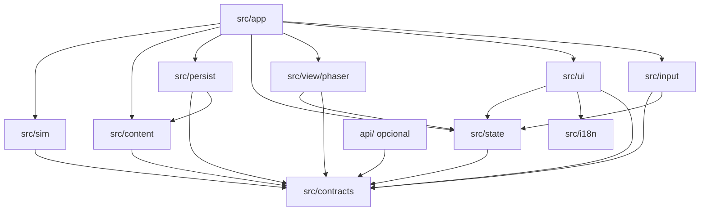
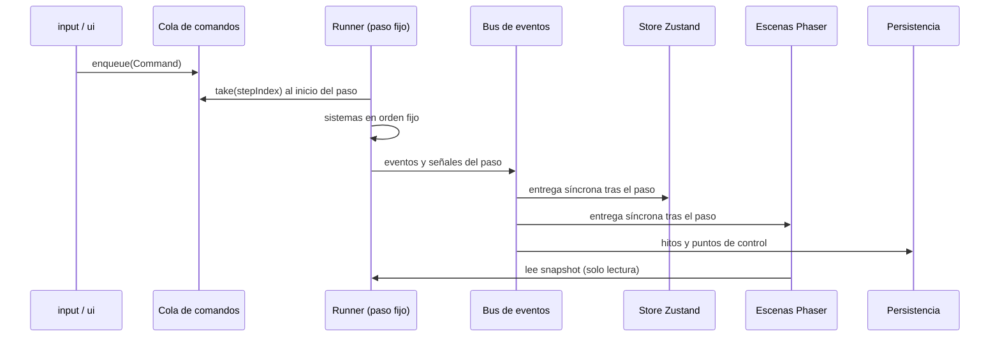

# Estructura de código y plan de pruebas de la demo

Esquemática técnica de la demo `MIS-DEMO-01`. Define carpetas, capas, comandos, eventos, modelo de estado, contenido, escenas, interfaz, guardado, depuración, propiedad de carpetas y la matriz de pruebas. **No hay código.** Los tipos se describen con tablas y las funciones en prosa. Igual que en [contratos](CONTRATOS.md), esto no es un esquema ejecutable.

Documentos relacionados: [GDD de la demo](../02-Diseno/DEMO/GDD-DEMO.md) (modos, transiciones, V1–V6 y W1–W5, IDs), [parámetros](../02-Diseno/DEMO/PARAMETROS-DEMO.md) (fuente única de valores), [mecánicas](../02-Diseno/DEMO/MECANICAS.md) (reglas, idempotencia, informe), [físicas](../02-Diseno/DEMO/FISICAS.md) (bucle, vuelo, movimiento, proyección), [diseño de nivel](../02-Diseno/DEMO/DISENO-DE-NIVEL.md), [greybox](../05-Arte/GREYBOX.md), [arquitectura](ARQUITECTURA.md), [guardado](GUARDADO.md) y [aceptación y pruebas](../07-Calidad/ACEPTACION-Y-PRUEBAS.md).

Si hay conflicto, mandan las reglas de mecánicas y físicas y los valores de parámetros. Esta esquemática solo fija dónde vive cada pieza y cómo se comunican.

## 1. Propósito y regla de ejecución

Este documento describe cómo se organizará el código de la demo para que varias personas y agentes trabajen en paralelo sin pisarse. **Solo se lleva a cabo dentro de la ventana autorizada de la hackathon** ([ADR 003](ADR/ADR-003.md)). Antes de esa apertura no se crean `package.json`, `src/`, configuraciones, ramas de implementación ni assets del reto.

Principios heredados del canon:

- La simulación (`src/sim/`) no depende de React, Phaser, Dexie, el DOM ni la red ([arquitectura](ARQUITECTURA.md)).
- La interfaz y las escenas solo leen el estado y envían comandos. No guardan una segunda copia de las reglas.
- La IA es opcional (`POST /api/companion/chat`, [OPT-01](../06-Produccion/BACKLOG.md)) y nunca modifica progreso, recursos ni recompensas ([ADR 002](ADR/ADR-002.md)).
- Recoger no es lo mismo que validar. Entregar `ITEM-AUR-LOG-PARTIAL` **no valida AUR-E03** ([historia principal — spoilers](../02-Diseno/HISTORIA-PRINCIPAL.md)).
- LUMA no tiene estadística de salud en la demo. Solo muestra reacciones escritas ([LUMA](../02-Diseno/LUMA.md)).
- El presupuesto de pagos es cero. El cliente no contiene secretos.
- Los valores numéricos se citan por su nombre en [parámetros](../02-Diseno/DEMO/PARAMETROS-DEMO.md), incluida su tabla de parámetros técnicos aceptados. Lo que aún falta está en la [sección 14](#14-parámetros-propuestos).

## 2. Árbol de carpetas previsto

Los archivos de la raíz aparecen solo como nombres. Sus contenidos y versiones se fijan el día 14 ([sección 12](#12-checklist-del-día-14)).

```text
nasa-orbita/
├── package.json                  (nombres de scripts: dev, build, typecheck, lint, test, e2e)
├── pnpm-lock.yaml
├── tsconfig.json
├── vite.config.ts
├── vitest.config.ts
├── playwright.config.ts
├── eslint.config.js              (incluye reglas de importación por capa)
├── vercel.json
├── index.html
├── .github/workflows/ci.yml
├── public/                       (favicon, fuentes subset; sin assets del reto antes de la ventana)
├── api/                          (opcional, OPT-01)
│   └── companion/chat.ts
├── src/
│   ├── contracts/                (tipos compartidos: comandos, eventos, estado, definiciones)
│   ├── sim/
│   │   ├── core/                 (runner de paso fijo, acumulador, bus de eventos, PRNG, reloj)
│   │   ├── state/                (creación de GameState, snapshot, conversión a SaveGame)
│   │   ├── commands/             (validación y despacho de comandos por modo)
│   │   └── systems/
│   │       ├── planner/          (computePlan, estimateSurface, V1–V6, W1–W5)
│   │       ├── resources/        (propelente, energía de equipo, reserva del relé)
│   │       ├── cruise/
│   │       ├── flight/           (aproximación, asistente, reserva p*, descenso y ascenso)
│   │       ├── surface/          (movimiento, colisiones, sombra, reloj de misión)
│   │       ├── interaction/      (actividades en lugares de interés)
│   │       ├── incident/         (INC-RELAY-01: energía, dial y alineación)
│   │       ├── lifeSupport/
│   │       ├── luma/             (seguimiento y reacciones escritas)
│   │       ├── report/           (previsto frente a real, reglas C-01…C-19, AttemptSummary)
│   │       └── progress/         (conjuntos de IDs, eventKey, objetivos, hitos)
│   ├── content/
│   │   ├── modules.json · tanks.json · mission.json · parameters.json
│   │   ├── pois.json · luma-reactions.json · dialogue.json · sources.json · causes.json
│   │   ├── maps/                 (MAP-DEMO-01: exportación Tiled JSON)
│   │   ├── schemas/              (esquemas Zod de cada archivo)
│   │   └── loader/               (carga, validación cruzada, informe de errores)
│   ├── view/phaser/
│   │   ├── scenes/               (Boot, Preload, Cruise, Approach, Surface, Ascent)
│   │   ├── render/               (registro de visuales por ID, greybox, interpolación, profundidad)
│   │   └── director/             (ModeDirector: arranca y detiene escenas según el modo)
│   ├── ui/                       (React)
│   │   ├── screens/              (Menu, Briefing, Planner, Report, Settings)
│   │   ├── overlays/             (HUD, Dialogue, Journal, Map, Pause, paneles de decisión, DebugPanel)
│   │   └── components/
│   ├── input/                    (mapa de teclas, remapeo, mando, compuerta de foco)
│   ├── state/                    (puente Zustand: store, selectores, muestreo del HUD)
│   ├── persist/                  (Dexie, export/import, migraciones, respaldo)
│   ├── i18n/                     (es.json, en.json, formato numérico)
│   └── app/                      (raíz de composición: crea sim, store, persistencia, Phaser y React)
└── tests/
    ├── unit/                     (Vitest, una carpeta por sistema)
    ├── fixtures/                 (partidas de prueba SaveGame v1, contenido roto a propósito)
    └── e2e/                      (Playwright)
```

Esta esquemática añade `src/contracts/`, `src/input/` y `src/app/` a la lista inicial. Así los tipos compartidos, el control de foco y el cableado tienen un responsable claro.

### Responsabilidad de cada carpeta

| Carpeta | Responsabilidad | Puede importar |
| --- | --- | --- |
| `src/contracts/` | Tipos de comandos, eventos, estado, definiciones de contenido y códigos de validación. No contiene lógica ni dependencias. | Nada. |
| `src/sim/` | Reglas, tiempo, estado y eventos. Recibe el contenido ya validado por inyección y los comandos en cola. | `contracts`. |
| `src/content/` | Datos JSON, esquemas Zod y validación cruzada. Entrega un `ContentBundle` inmutable. | `contracts`, Zod. |
| `src/view/phaser/` | Dibujar, animar, gestionar la cámara y la profundidad. Lee snapshots. | `contracts`, Phaser, lecturas del `state`. |
| `src/ui/` | Pantallas, superposiciones y paneles React. Envía comandos y muestra selectores. | `contracts`, `state`, `i18n`, React. |
| `src/input/` | Convertir teclado y mando en comandos. Bloquea teclas de juego cuando el foco está en una superposición o un campo de texto. | `contracts`, `state`. |
| `src/state/` | Store Zustand, selectores derivados y muestreo a `hudUpdateHz`. Es el único puente entre el runner y React. | `contracts`, Zustand. |
| `src/persist/` | Base de datos IndexedDB, transacciones, respaldo, exportación, importación y migraciones. | `contracts`, `content/schemas`, Dexie. |
| `src/i18n/` | Cadenas por idioma y formato de números y unidades. | Nada fuera de sí misma. |
| `src/app/` | Composición, controlador de frames, visibilidad de pestaña y modo de pruebas. | Todo. |
| `api/` | Función opcional de Vercel para OPT-01. Lee credenciales solo del entorno del servidor. | `contracts` (tipos de petición y respuesta). |
| `tests/` | Pruebas unitarias y e2e, y fixtures. | Todo, excepto que `tests/e2e` usa solo el navegador y `window.__ORBITA_TEST__`. |

### Capas y reglas de importación



Las flechas indican «importa». Las reglas se comprueban con lint en CI:

1. `src/sim/` **no importa** `view`, `ui`, `state`, `persist`, `input`, `app`, Phaser, React, Zustand, Dexie, `fetch`, `window` ni `document`. Tampoco usa `Math.random`, `Date.now` ni `performance.now` ([físicas](../02-Diseno/DEMO/FISICAS.md)).
2. `src/contracts/` no importa nada.
3. `src/ui/` y `src/view/` no importan `src/sim/systems/`. Toda regla llega como dato del estado o resultado de un evento.
4. `src/view/` no importa `src/ui/` y al revés. Se comunican por el store.
5. Solo `src/app/` conoce todas las piezas. Ninguna otra carpeta crea instancias de otra capa.
6. `api/` no se importa desde el cliente. El cliente lo llama solo por HTTP.

## 3. Flujo comando → simulación → eventos → vistas



El controlador de frames de `src/app/` se engancha al bucle de Phaser y llama a `advance(realDtMs)`. La simulación no sabe quién la llama y las pruebas la invocan directamente. El acumulador, el límite `maxSubstepsPerFrame`, la pausa sin ráfaga de recuperación, la interpolación con `alpha` y la marca `teleported` siguen el pseudocódigo de [físicas](../02-Diseno/DEMO/FISICAS.md). Aquí solo se añade el reparto de responsabilidades:

```text
src/app  FrameDriver.onFrame(nowMs)  → runner.advance(realDtMs × testTimeScale)
src/sim  runner.advance              → 0…maxSubstepsPerFrame llamadas a step(state, commands)
src/sim  step                        → comandos → sistemas → transición de modo → lista de eventos
src/sim  fin del frame               → publica snapshot {prev, curr, alpha} y entrega eventos y señales
```

`dt = 1/simHz`. Los temporizadores se cuentan en pasos enteros (`cruiseStep`, `holdSteps`, reloj de misión). El tiempo de misión en superficie sigue `surfaceTimeScale`. El crucero reparte `cruisePhysicalHours` en `cruiseRealSeconds`. La aproximación va en tiempo real.

**Orden fijo de sistemas en un paso** (se alinea con [físicas](../02-Diseno/DEMO/FISICAS.md)):

1. Comandos encolados para ese paso.
2. Sistemas del modo:
   - PLANNER: `planner`.
   - CRUISE: `cruise`.
   - APPROACH: `flight` (control → integración → comprobaciones, con la reserva primero).
   - LANDING y ASCENT: `flight` (resolución en el paso de entrada y contador de secuencia).
   - SURFACE: `surface` (movimiento y colisión del jugador) → `luma` (seguimiento) → `surface` (consulta de interactuables, banderas de entorno y reloj de misión) → `interaction` → `incident` → `resources` → `lifeSupport`.
3. `progress` → `luma` (reacciones) → `report`.
4. Transición de modo.
5. Emisión de eventos en orden `(stepIndex, orden del sistema, secuencia)`.

### Catálogo de comandos

Los comandos son intenciones. La simulación puede rechazarlos sin efecto, y un rechazo nunca genera un evento de progreso ni consume tiempo. Un comando rechazado deja un motivo en el estado transitorio `lastRejection` (clave de texto traducible) y en el panel de depuración. Los nombres de los comandos van en imperativo (`DeselectModule`) y los eventos en pasado (`ModuleDeselected`).

| Comando | Payload | Modo válido | Validación |
| --- | --- | --- | --- |
| StartNewGame | — | MENU | Ninguna. Crea el estado inicial y pasa a BRIEFING. |
| ContinueGame | — | MENU | Existe un SaveGame válido. Pasa a RESUME. |
| AcknowledgeBriefing | — | BRIEFING | Ninguna. Pasa a PLANNER (CP-PLAN). |
| SelectModule | `moduleId` | PLANNER | Existe en el contenido y no está seleccionado. |
| DeselectModule | `moduleId` | PLANNER | Está seleccionado y es removible. Con `MOD-LUMA-SHIELD` no cambia el estado ni emite evento; deja el mensaje de preinstalado ([mecánicas](../02-Diseno/DEMO/MECANICAS.md)). |
| SelectTank | `tankId` (TANK-S/M/L) | PLANNER | Existe en el contenido. Sustituye al anterior. Siempre hay un tanque. |
| LaunchMission | — | PLANNER | Emite siempre `PlanValidated`. Solo lanza si no hay V1–V6. Si hay errores, el foco pasa a la lista de errores. Los avisos W1–W5 no bloquean. |
| ChooseMidcourse | `kind` (now, late) | CRUISE | `midcourseResolved` = pending. `now` solo dentro de [`midcourseDecisionOpenS`, `midcourseDecisionCloseS`). `late` aplaza el consumo hasta el cierre. |
| RequestLumaRest | — | CRUISE | Escena `LUMA-R-CRUISE-REST` aún no vista en el intento. Abre DIALOGUE. |
| SetFlightInput | `thrust`, `retro`, `turn` (−1/0/1), `strafe` (−1/0/1), `precision` (bool) | APPROACH | Sin superposición ni foco de texto. Se mantiene hasta el siguiente comando. |
| ToggleAssist | — | APPROACH | Sin fallo pendiente. W lo desactiva ([físicas](../02-Diseno/DEMO/FISICAS.md)). |
| AbortApproach | — | APPROACH | Sin fallo pendiente. Emite `ApproachAborted { reason: player }`. |
| RetryApproach | — | APPROACH, con `ApproachFailed` o `ApproachAborted` pendiente | Restaura la instantánea de CP-APPROACH y suma `approachRetries`. |
| GoToReport | — | APPROACH, con fallo o aborto pendiente | Pasa a REPORT con resultado de aborto. |
| SetMoveInput | `x`, `y` (ejes de pantalla −1/0/1) | SURFACE | Sin superposición, panel de decisión, actividad en curso ni regreso de emergencia. La conversión a ejes lógicos está en físicas. |
| Interact | `targetId`, `actionId` | SURFACE | Distancia ≤ `interactRadiusM`. Módulos y precondiciones de la acción comprobados **antes** de empezar. Si es imposible, se rechaza sin consumir tiempo. |
| Scan | `targetId` | SURFACE | Distancia ≤ `scanRadiusM` y `MOD-SCANNER` a bordo. |
| CancelActivity | — | SURFACE, con actividad en curso | La actividad se detiene sin resultado. El tiempo transcurrido sí se consume. |
| RotateRelayDial | `direction` (−1, +1) | Panel de alineación manual abierto | Un paso de los `relayAlignPositions`. Con el panel abierto, el reloj de misión está congelado. |
| AutoSweepRelay | — | Panel de alineación manual abierto | Gira hasta la señal máxima. Mismo coste que hacerlo a mano. |
| ConfirmRelayAlignment | — | Panel de alineación manual, señal 4/4 | Inicia la actividad de `relayAlignManualMin`. |
| ClosePanel | `panelId` | SURFACE, con panel de decisión abierto | Cierra el panel (relé, revisar estado, confirmar despegue). |
| RequestAscent | `confirmed` (bool) | SURFACE, a ≤ `interactRadiusM` de DEMO-POI-01 | Si el objetivo principal no está completo, hace falta `confirmed` = true porque será un aborto. Pasa a ASCENT. |
| OpenOverlay | `overlay` (PAUSE, DIALOGUE, JOURNAL, MAP) | Cualquiera con simulación activa | No hay otra superposición modal, salvo PAUSE, que siempre puede abrirse. |
| CloseOverlay | `overlay` | Cualquiera | Esa superposición está abierta. |
| ChooseDialogueOption | `nodeId`, `optionId` | DIALOGUE | El nodo está activo y la opción cumple sus requisitos. |
| RetryPlanning | — | REPORT | Nuevo intento (`attemptId` + 1) y vuelta a PLANNER (CP-PLAN) con la configuración anterior precargada. |
| FinishMission | — | REPORT | Archiva la misión y pasa a END. |
| ReturnToMenu | — | END, PAUSE | Ninguna. |
| SetTimeScale | `factor` | Cualquiera | **Solo en la build de pruebas.** Límite de `testTimeScaleMax`. |

`LANDING` y `ASCENT` no aceptan comandos de control. Se resuelven en el paso de entrada ([físicas](../02-Diseno/DEMO/FISICAS.md)): consumo, evento y punto de control. Después duran `landingSequenceRealS` y `ascentSequenceRealS`, contados por la simulación. La animación nunca decide el resultado. `BOOT`, `RESUME` y `END` los gestiona `src/app/`, que los traduce a los comandos anteriores.

### Catálogo de eventos canónicos

La idempotencia sigue [mecánicas](../02-Diseno/DEMO/MECANICAS.md): cada evento de progreso tiene una clave `eventKey = attemptId : tipo : subjectId`. `progress` ignora una clave que ya esté en `processedEventKeys`. El estado se guarda en conjuntos, no en contadores. Reprocesar un comando, recargar o repetir una interacción no vuelve a emitir el evento ni concede otra recompensa.

| Evento | Payload | Emite | Observan | Idempotencia |
| --- | --- | --- | --- | --- |
| ModuleSelected | `moduleId` | planner | ui | Informativo. No da progreso. |
| ModuleDeselected | `moduleId` | planner | ui | Informativo. |
| TankSelected | `tankId` | planner | ui | Informativo. |
| PlanValidated | `errors` (V1–V6), `warnings` (W1–W5), `estimate` | planner, al pulsar lanzar | ui, report | Informativo y determinista. |
| LaunchApproved | `attemptId`, `config` (módulos y tanque), `estimate` | planner | report, persist, view | Uno por intento. Congela la estimación del intento. |
| MidcourseCorrected | `kind` (now, late), `kg` | cruise | report, ui, persist | Uno por intento (`midcourseResolved` ≠ pending). |
| ApproachFailed | `reason` (overspeed, lost) | flight | ui, report, view | Uno por intento de aproximación. Suma `approachRetries` solo si se reintenta. |
| ApproachAborted | `reason` (reserve, player), `propellantKg` | flight | ui, report, persist | Uno por intento de aproximación. |
| Landed | `propellantKg` | flight (entrada en LANDING) | report, luma, persist (CP-SURFACE), view | Uno por intento. |
| ObservationRecorded | `observationId` (OBS-TERRAIN-01, OBS-GEO-01) | interaction | progress, luma, report, persist | `eventKey`. Se añade al diario del perfil (unión de todos los intentos). |
| SampleCollected | `itemId` (ITEM-SAMPLE-REGOLITH-01) | interaction | progress, luma, report, persist | `eventKey`. |
| ItemRecovered | `itemId` (ITEM-AUR-LOG-PARTIAL) | interaction | progress, luma, report, persist | `eventKey`. Solo marca «recuperado». |
| RelayPowered | `source` (battery, solar) | incident | progress, luma, report, persist | `eventKey`. |
| RelayAligned | `method` (toolkit, manual) | incident | progress, luma, report, persist | `eventKey`. |
| LinkRestored | `incidentId` (INC-RELAY-01) | incident, con energía y alineación | progress, luma, report, persist | `eventKey`. Puede emitirse con el jugador lejos del relé. |
| ItemDelivered | `itemId` | interaction (DEMO-POI-06), uno por objeto | progress, luma, report, persist | `eventKey` + `rewardsGranted` por perfil. Nunca toca la evidencia validada. |
| LifeSupportWarning | `remainingMin`, `thresholdMin` | lifeSupport | ui, luma | Uno por intento (`lifeSupportWarned`). |
| EmergencyReturn | — | lifeSupport, al llegar a 0 | ui, report, persist | Uno por intento. Interrumpe la actividad y lleva al astronauta y a LUMA a DEMO-POI-01, y de ahí a ASCENT. |
| AscentCompleted | `propellantUsedKg`, `remainingKg` | flight (entrada en ASCENT) | report | Uno por intento (bandera persistente). |
| ReportReady | `attemptId`, `outcome` (success, partial, abort) | report, al entrar en REPORT | ui, persist | Uno por intento. |
| LumaReaction | `reactionId` (LUMA-R-*) | luma | ui, view, persist | `reactionsShown` del intento. Solo registro: no da progreso ni cambia recursos. |

### Bus de eventos

- Durante un paso, los eventos se acumulan en orden de emisión en una lista del paso. Los sistemas posteriores del mismo paso pueden leerla. Por ejemplo, `luma` ve el `ItemRecovered` que `interaction` emitió antes.
- Al terminar el paso, el runner entrega la lista **de forma síncrona y en el mismo orden** a los observadores externos (store, escenas, persistencia). Primero publica el snapshot nuevo y después entrega los eventos.
- **No es reentrante.** Un observador no puede emitir eventos. Si envía un comando, este entra en la cola y se aplica en el paso siguiente.
- Un error en un observador se registra y no interrumpe a los demás ni corrompe el estado.
- **Señales internas.** Además de los eventos canónicos, el runner informa tres señales que no son eventos de juego: `modeTransition` (de, a), `checkpointReached` (CP-PLAN, CP-APPROACH, CP-SURFACE) y `milestoneReached` (ID del hito). Las usan la persistencia y el `ModeDirector`. La UI y LUMA no reaccionan a ellas.

## 4. Modelo de estado

Columna **P/T**: P se serializa en SaveGame (estable) y T es transitorio, así que se reconstruye o se descarta al cargar. Las unidades siguen [parámetros](../02-Diseno/DEMO/PARAMETROS-DEMO.md). En superficie, las coordenadas lógicas están en metros, con origen en la esquina noroeste, `x` hacia el este e `y` hacia el sur. El vuelo usa su propio marco relativo al objetivo ([físicas](../02-Diseno/DEMO/FISICAS.md)). La proyección isométrica nunca entra en el estado. La masa no se guarda: se deriva como `landerDryMassKg + payloadKg + propellantKg`.

### GameState (raíz)

| Campo | Tipo | Unidad | P/T | Descripción |
| --- | --- | --- | --- | --- |
| mode | enumeración de modos de juego | — | P | En SaveGame se guarda como `resumeMode`. |
| overlays | lista de PAUSE, DIALOGUE, JOURNAL, MAP | — | T | Una superposición abierta pausa la simulación. |
| decisionPanel | relayPanel, relayDial, statusReview, ascentConfirm o nulo | — | T | Los paneles de decisión congelan el reloj de misión ([mecánicas](../02-Diseno/DEMO/MECANICAS.md)). |
| paused | booleano | — | T | Derivado de `overlays`, del foco de texto y de la visibilidad de la pestaña. |
| stepIndex | entero | pasos | T | Contador de pasos desde que se cargó. |
| rngSeed | entero | — | P | `rngSeed`. Los flujos del PRNG se derivan de la semilla y de un identificador de flujo. |
| missionId | ID | — | P | `MIS-DEMO-01`. |
| missionStatus | disponible, planificacion, validada, transito, operacion, retorno, informe, archivada | — | P | Correspondencia en el [GDD](../02-Diseno/DEMO/GDD-DEMO.md). |
| attemptId | entero ≥ 1 | — | P | Sube con cada RetryPlanning. |
| lastCheckpointId | CP-PLAN, CP-APPROACH, CP-SURFACE o ID de hito | — | P | Último punto de reanudación. |
| plan | PlanState | — | P | — |
| cruise | CruiseState | — | P | — |
| flight | FlightState | — | T (salvo resumen) | — |
| surface | SurfaceState | — | P (en hito) | — |
| inventory | InventoryState | — | P | — |
| progress | ProgressState | — | P | — |
| incident | IncidentState | — | P | — |
| luma | LumaDemoState | — | P (parcial) | — |
| report | ReportData o nulo | — | P | Se genera al entrar en REPORT. |
| settings | `pauseOnDecisions`, `hideLumaReactions` | — | P (en ajustes) | Opciones de accesibilidad que afectan a las reglas. Se inyectan desde la tabla de ajustes. |
| lastRejection | código y clave de texto, o nulo | — | T | Motivo del último comando rechazado. |

### PlanState

Cálculo en vivo con `computePlan` y `estimateSurface` de [mecánicas](../02-Diseno/DEMO/MECANICAS.md). Todo lo derivado es T y se recalcula con cada cambio.

| Campo | Tipo | Unidad | P/T | Descripción |
| --- | --- | --- | --- | --- |
| selectedModuleIds | conjunto de MOD-* | — | P | Siempre incluye `MOD-LUMA-SHIELD`. Un intento nuevo empieza con LUMA-SHIELD y TANK-M, o con la configuración anterior si viene de RetryPlanning. |
| tankId | TANK-S, TANK-M, TANK-L | — | P | — |
| payloadKg | número | kg | T | Se compara con `payloadCapacityKg` (V1). |
| costCr | número | cr | T | Módulos más tanque. Se compara con `budgetCredits` (V2). |
| neededKg | número | kg | T | «Necesario» según [parámetros](../02-Diseno/DEMO/PARAMETROS-DEMO.md). Usa siempre `returnCargoKg` completo. |
| requiredKg | número | kg | T | `neededKg × (1 + propellantMarginHard)` (V5). |
| margin | número | fracción | T | Propelente del tanque / necesario − 1 (W1 con `propellantMarginWarn`). |
| estimate | ruta, metros, metros en sombra, min de soporte vital, capacidad, Wh, min en el relé; o nula con V4 | m, min misión, Wh | T | Base de W3, W4 (`lifeSupportPlanWarnFraction`) y del informe. |
| errors | lista de V1–V6 | — | T | Tabla del [GDD](../02-Diseno/DEMO/GDD-DEMO.md). Bloquea el lanzamiento. |
| warnings | lista de W1–W5 | — | T | No bloquea. W5 = sin MOD-TOOLKIT, la alineación será manual. |
| frozenEstimate | copia de `estimate` y de las cifras de propelente | — | P | Se fija con LaunchApproved. Es la columna «previsto» del informe. |
| approved | booleano | — | P | Después de LaunchApproved el plan ya no se edita en ese intento. |

### CruiseState

Sigue el modelo por tramo de [físicas](../02-Diseno/DEMO/FISICAS.md). Todo es P, así que `RESUME → CRUISE` restaura el tramo exacto sin volver a consumir.

| Campo | Tipo | Unidad | P/T | Descripción |
| --- | --- | --- | --- | --- |
| cruiseStep | entero 0…`cruiseRealSeconds × simHz` | pasos | P | Progreso del tramo. No avanza en pausa ni con `pauseOnDecisions` y la ventana abierta. |
| midcourseResolved | pending, now, late | — | P | Garantiza una única corrección por intento. El consumo y este indicador cambian en el mismo paso. |
| midcourseDeferred | booleano | — | P | El jugador eligió «Más tarde». `midcourseLateKg` se aplica en el paso de `midcourseDecisionCloseS`, o al elegirlo si `pauseOnDecisions` está activo. |
| firedMilestones | conjunto de IDs de hito del tramo | — | P | Apertura y cierre de la decisión, llegada. No se repiten al reanudar. |
| lumaRestDone | booleano | — | P | `LUMA-R-CRUISE-REST` vista en este intento. |
| physicalHoursShown | número | h | T | `cruiseStep / pasos totales × cruisePhysicalHours`. Solo se muestra. |

### FlightState (aproximación, aterrizaje y ascenso)

Es un subconjunto del `FlightState` de [contratos](CONTRATOS.md): marco local, objetivo, posición, orientación, velocidad, combustible y asistencia. Los nombres siguen [físicas](../02-Diseno/DEMO/FISICAS.md). No se guarda un estado de vuelo intermedio: recargar durante la aproximación vuelve a CP-APPROACH.

| Campo | Tipo | Unidad | P/T | Descripción |
| --- | --- | --- | --- | --- |
| r | vector 2D | m | T | Posición relativa al objetivo, que está en el origen. Empieza en (0, −`approachStartDistM`). |
| v | vector 2D | m/s | T | Empieza con (`approachStartLateralMps`, `approachStartClosingMps`). |
| thetaDeg | número [0, 360) | ° | T | Empieza en `approachStartHeadingDeg`. Se compara con `landingSiteHeadingDeg` ± `landingHeadingTolDeg`. |
| input | thrust, retro, turn, strafe, precision | — | T | Último SetFlightInput. Se lee como cero con foco fuera del juego. |
| assistActive | booleano | — | T | Termina al llegar a `assistDoneSpeedMps` o al pulsar W. |
| holdSteps | entero | pasos | T | Pasos consecutivos dentro de las condiciones. LANDING al llegar a `landingHoldS × simHz`. |
| inZonePrev | booleano | — | T | Detecta la entrada en la zona (exceso de velocidad). |
| reserveKg | número | kg | T | Umbral fijo `p*` de [parámetros](../02-Diseno/DEMO/PARAMETROS-DEMO.md). Calculado con `returnCargoKg` completo. |
| spareKg | número | kg | T | `propellantKg − p*`: «sobrante para corregir» del HUD. |
| pendingOutcome | `failed` (overspeed, lost), `aborted` (reserve, player) o nulo | — | T | Espera a RetryApproach o GoToReport. |
| checkpointPropellantKg | número | kg | P | Propelente en CP-APPROACH. Base de cada reintento. |
| approachRetries | entero | — | P | Para el informe (C-09). |
| assistKg, assistExtraKg | números | kg | P | Gasto con asistente y su exceso por `assistPropellantPenalty` (C-08). |
| sequenceRemainingSteps | entero | pasos | T | Contador de LANDING o ASCENT. |
| ascentResolved | booleano | — | P | `AscentCompleted` ya aplicado en este intento. |

El ascenso real calcula su consumo con la carga que se lleve en ese momento: 0–3 kg según los objetos en `inventory.items` ([parámetros](../02-Diseno/DEMO/PARAMETROS-DEMO.md)). V5 y la reserva usan siempre `returnCargoKg` completo, que es el caso conservador.

### SurfaceState

| Campo | Tipo | Unidad | P/T | Descripción |
| --- | --- | --- | --- | --- |
| playerPosM | vector 2D | m | P (en hito) | Posición lógica del pie del astronauta. Al recargar se usa la del lugar del último hito. |
| playerVelMps | vector 2D | m/s | T | Limitada por `walkSpeedMps`, `walkAccelMps2` y `walkDecelMps2`. |
| facing | una de 8 direcciones | — | T | Solo para la vista. |
| lumaPosM, lumaMode | vector 2D; FOLLOW, REGROUP… | m | T | Seguimiento de [físicas](../02-Diseno/DEMO/FISICAS.md). Se reubica junto al jugador al cargar. |
| cell, inShadow, lampOn | celda; booleanos | — | T | Banderas de entorno derivadas del mapa y de `MOD-LAMP`. |
| missionClockSteps | entero | pasos | P | Reloj de misión del intento. Los minutos se derivan con `surfaceTimeScale`. |
| activity | `actionId`, `targetId`, pasos restantes, o nulo | — / pasos | T | Una actividad interrumpida por recarga no se completa ni se cobra otra vez. |
| emergencyReturnActive | booleano | — | T | El regreso automático a DEMO-POI-01 está en curso. Bloquea la entrada. |
| lastMilestonePoiId | DEMO-POI-* | — | P | Lugar al que se vuelve al recargar. |
| walkedM, shadowWalkedM | números | m | P | Recorrido total y en sombra (informe, C-02, C-03). |
| cancelledMin | número | min misión | P | Tiempo de actividades canceladas (C-11). |

### InventoryState (recursos y objetos)

| Campo | Tipo | Unidad | P/T | Descripción |
| --- | --- | --- | --- | --- |
| propellantKg | número | kg | P | Depósito único: corrección, aproximación, descenso y ascenso. |
| energyWh | número | Wh | P | Energía de equipo: `toolBatteryBaseWh` (+ `batteryPackWh`). |
| reservedRelayWh | número | Wh | T | Reserva del relé con batería mientras esté pendiente ([mecánicas](../02-Diseno/DEMO/MECANICAS.md)). |
| availableWh | número | Wh | T | `energyWh − reservedRelayWh`. Decide si se puede cruzar la sombra. |
| lifeSupportMin | número | min misión | P | Restante. Capacidad: `lifeSupportBaseMin` (+ `o2ReserveMin`). |
| lifeSupportCapMin | número | min misión | P | Capacidad del intento. |
| lifeSupportWarned | booleano | — | P | `LifeSupportWarning` ya emitido en este intento. |
| items | conjunto de ITEM-* | — | P | Objetos llevados y aún no entregados (`inventory` en mecánicas). |

El aviso de soporte vital y `EmergencyReturn` miden el regreso hasta **DEMO-POI-01**, el punto de regreso en superficie según [parámetros](../02-Diseno/DEMO/PARAMETROS-DEMO.md). `RequestAscent` también se hace allí. La entrega se hace en DEMO-POI-06, a unos 7 m.

### ProgressState (conjuntos de IDs)

Tiene dos niveles, como establece el [GDD](../02-Diseno/DEMO/GDD-DEMO.md). Los campos **de intento** se reinician con RetryPlanning. Los campos **de perfil** se conservan entre intentos, y en ellos se apoya la regla de no duplicar recompensas.

| Campo | Tipo | Nivel | P/T | Descripción |
| --- | --- | --- | --- | --- |
| observations | conjunto de OBS-* | intento | P | Puntuación científica del intento. |
| recovered | conjunto de ITEM-* | intento | P | «Recuperado» (registro, muestra). |
| delivered | conjunto de ITEM-* | intento | P | «Entregado» en DEMO-POI-06. |
| visitedPoiIds | conjunto de DEMO-POI-* | intento | P | Lugares alcanzados. |
| reactionsShown | conjunto de LUMA-R-* (con variante) | intento | P | Una reacción por intento, salvo que su definición diga otra cosa. |
| processedEventKeys | conjunto de `eventKey` | intento | P | Base de la idempotencia. |
| primaryComplete | booleano | intento | T | Derivado: `ItemRecovered`, `LinkRestored` e `ItemDelivered` del registro. |
| scienceScore | 0–3 | intento | T | Derivado: OBS-TERRAIN-01 + OBS-GEO-01 + muestra **entregada**. |
| journalObservations | conjunto de OBS-* | perfil | P | Unión de todos los intentos. El conocimiento registrado se conserva incluso tras un aborto. |
| rewardsGranted | conjunto de IDs | perfil | P | Cada recompensa de entrega se da una sola vez por misión. |
| attemptSummaries | lista de AttemptSummary | perfil | P | Para comparar con el intento anterior ([mecánicas](../02-Diseno/DEMO/MECANICAS.md)). |
| dialogueChoices | mapa nodo → opción | perfil | P | Decisiones de conversación conservadas. No tienen evento canónico. |
| auroraEvidence.recoveredPieceIds | conjunto | perfil | P | Contiene ITEM-AUR-LOG-PARTIAL tras ItemRecovered. |
| auroraEvidence.validatedEvidenceIds | conjunto de AUR-E* | perfil | P | **Siempre vacío en la demo.** Existe para conservar la distinción del canon. |
| auroraEvidence.revealedDestinations | conjunto | perfil | P | Sin cambios en la demo. No revela Marte. |

### IncidentState (INC-RELAY-01)

| Campo | Tipo | Unidad | P/T | Descripción |
| --- | --- | --- | --- | --- |
| powered | booleano | — | P | — |
| source | battery, solar o nulo | — | P | — |
| panelDeployed | booleano | — | P | — |
| solarWh | número | Wh | P | Carga acumulada hasta `relayEnergyWh` (`relaySolarChargeMin` con `solarPanelW`). Sigue con el reloj aunque el jugador se aleje. |
| aligned | booleano | — | P | — |
| method | toolkit, manual o nulo | — | P | — |
| dialPosition | 0…`relayAlignPositions` − 1 | — | T | Posición del dial manual. La señal máxima la fija el [diseño de nivel](../02-Diseno/DEMO/DISENO-DE-NIVEL.md). |
| alignedBeforeDeploy | booleano | — | P | Indica si hubo solapamiento con la carga solar (C-05, C-17). |
| linkRestored | booleano | — | P | — |

La alineación en curso es una actividad (T). Si se recarga a mitad, se vuelve al último hito y la alineación vuelve a empezar.

### LumaDemoState

LUMA **no tiene salud, energía ni condición variable en la demo**. Su paleta corresponde a la etapa del capítulo 2 y es una constante de contenido, no un estado.

| Campo | Tipo | Unidad | P/T | Descripción |
| --- | --- | --- | --- | --- |
| queue | hasta 2 LUMA-R-* | — | T | Si se llena, se descarta la más antigua, salvo `LUMA-R-LOWLS`, que tiene prioridad. |
| gapRemainingS | número | s reales | T | Separación global entre burbujas (`lumaReactionMinGapS`). |
| bubble | `reactionId` y tiempo restante (`lumaBubbleS`), o nulo | s reales | T | Burbuja no modal visible. |
| repeatCooldowns | mapa LUMA-R-* → s restantes | s reales | T | Repetición de la misma reacción (`lumaReactionCooldownS`). |

Lo persistente de LUMA (`reactionsShown`) vive en ProgressState. Las reacciones esperan a que termine la aproximación, una actividad o una superposición.

### ReportData (previsto frente a real)

La estructura y las reglas causales C-01 a C-19 están en [mecánicas](../02-Diseno/DEMO/MECANICAS.md). Aquí solo se describe la forma del dato.

| Campo | Tipo | Unidad | Descripción |
| --- | --- | --- | --- |
| attemptId | entero | — | Intento al que corresponde. |
| outcome | success, partial, abort | — | Tabla de resultados del [GDD](../02-Diseno/DEMO/GDD-DEMO.md). |
| primary | recogido, enlace, entregado (estado de cada uno) | — | Incluye la línea fija «pendiente de autenticación». |
| science | `scienceScore` y lista de lo obtenido | — | — |
| rows | lista de filas: propelente, soporte vital, energía, tiempo en el relé | kg, min misión, Wh | Cada fila con `predicted` (de `frozenEstimate`), `actual`, desglose y nivel O/S/F. |
| causes | lista de ID C-* con sus valores interpolados | — | Ordenadas por impacto. La diferencia que merece nota usa `reportDeltaNoteFraction`. |
| comparison | diferencias con el AttemptSummary anterior, o nula | — | Decisiones y resultados con signo. |
| sourceIds | conjunto de IDs de ScienceSource | — | Fuentes consultables desde el informe. |
| nextClue | clave de texto | — | Pista visible final. No confirma Marte ni valida AUR-E03. |

`ReportData` se calcula con datos ya persistentes, de modo que regenerarlo tras una recarga da el mismo resultado.

## 5. Contenido y validación

El contenido es JSON en `src/content/`. Cada archivo tiene un esquema Zod en `src/content/schemas/`, y esos esquemas deben producir exactamente los tipos de `src/contracts/`. Los textos visibles se guardan como claves de i18n, salvo en `DialogueNode` y en las reacciones, que llevan el texto por idioma como pide [contratos](CONTRATOS.md).

### ModuleDefinition

| Campo | Tipo | Unidad | Descripción |
| --- | --- | --- | --- |
| id | MOD-* | — | Único. |
| nameKey | clave i18n | — | Nombre visible en ES y EN. |
| massKg | número > 0 | kg | Según la tabla de módulos. |
| costCredits | número ≥ 0 | cr | — |
| effects | lista de efectos | — | Tipo de efecto y nombre del parámetro que aplica (por ejemplo `batteryPackWh`). Nunca un número suelto. |
| enablesActionIds | lista de ACT-* | — | Acciones que habilita (escaneo, lámpara, alineación con kit…). |
| required | booleano | — | Interviene en V3 o V6. |
| removable | booleano | — | `false` solo para MOD-LUMA-SHIELD. |
| energySourceForIncident | booleano | — | Cuenta para V4. |

### TankDefinition

| Campo | Tipo | Unidad | Descripción |
| --- | --- | --- | --- |
| id | TANK-S, TANK-M, TANK-L | — | Único. |
| propellantKg | número | kg | Valores de [parámetros](../02-Diseno/DEMO/PARAMETROS-DEMO.md). |
| costCredits | número | cr | — |

### PoiDefinition

| Campo | Tipo | Unidad | Descripción |
| --- | --- | --- | --- |
| id | DEMO-POI-01 … 06 | — | Único. |
| nameKey | clave i18n | — | — |
| centerM | vector 2D | m | Según [parámetros](../02-Diseno/DEMO/PARAMETROS-DEMO.md). |
| radiusM | número | m | Zona del lugar. Se marca como visitado al entrar. |
| lighting | light, shadowEdge | — | — |
| elevated | booleano | — | Mirador. |
| role | returnPoint, delivery o ninguno | — | DEMO-POI-01 es el punto de regreso y DEMO-POI-06 el de entrega. |
| actions | lista de acciones | — | `actionId`, `input` (E o R), `requiresModuleIds`, `durationParam` (nombre de parámetro), `prerequisiteIds`, `produces` (OBS-*, ITEM-*, cambio de incidencia), `event` canónico emitido y `opensPanel` si abre un panel de decisión. |
| milestone | booleano | — | Completar la acción dispara `milestoneReached`. |
| sourceIds | lista de ScienceSource | — | Fuentes del lugar. |

### MapDefinition

Se obtiene de la exportación JSON de Tiled y se valida contra este esquema. La geometría, la leyenda y los waypoints los fija el [diseño de nivel](../02-Diseno/DEMO/DISENO-DE-NIVEL.md).

| Campo | Tipo | Unidad | Descripción |
| --- | --- | --- | --- |
| id | MAP-DEMO-01 | — | ID de la región de la demo. |
| tileSizeM | número | m | Igual a `tileSizeM`. |
| widthTiles, heightTiles | enteros | celdas | Iguales a `mapWidthTiles × mapHeightTiles`. |
| cells | matriz de celdas | — | Cada celda: `height` (nivel entero; vista con `heightStepPx`), `blocked` (bool), `shadow` (bool) y `terrain` (clave visual). |
| occluders | lista de elementos lógicos | m | Se atenúan a `occluderAlpha` cuando tapan al jugador o a LUMA. |
| poiIds | lista de DEMO-POI-* | — | Deben existir en `pois.json`. |
| spawnM | vector 2D | m | Aparición libre junto al módulo (DEMO-POI-01). |
| waypoints | lista de puntos con nombre | m | Usados por `walkTo` en pruebas y por el regreso de emergencia. |
| relayDialTarget | 0…`relayAlignPositions` − 1 | — | Posición de señal máxima del dial. |
| relief | artístico declarado o recorte LOLA declarado | — | Nivel S/F declarado ([GDD](../02-Diseno/DEMO/GDD-DEMO.md)). |

### LumaReactionDefinition

| Campo | Tipo | Unidad | Descripción |
| --- | --- | --- | --- |
| id | LUMA-R-* | — | Único. Puede tener variantes (A, B), como LUMA-R-SHADOW. |
| trigger | evento canónico o condición de estado | — | Por ejemplo `ItemRecovered` o «primer bloqueo en el borde de sombra». |
| conditions | lista de requisitos | — | Módulos, IDs de progreso o modo. |
| text | `{ es, en }` por variante | — | Gesto y traducción breve. |
| priority | entero | — | `LUMA-R-LOWLS` tiene prioridad en la cola. |
| limit | una por intento, una por variante y por intento… | — | Usa `reactionsShown`. |

Una reacción **no puede** declarar efectos sobre recursos, progreso o recompensas. El esquema no tiene ese campo.

### DialogueNode

| Campo | Tipo | Descripción |
| --- | --- | --- |
| id | ID | Único. |
| speaker | protagonista, LUMA (traductor), control de misión, sistema | — |
| text | `{ es, en }` | Ambos obligatorios y no vacíos. |
| options | lista de `{ id, text: { es, en }, nextId, requires }` | `nextId` debe existir o ser «fin». |
| requires | lista de requisitos | IDs de progreso o del plan. Solo se refieren a hechos ya ocurridos. |
| allowedEvents | lista | En la demo solo puede registrar `dialogueChoices`. No emite eventos de progreso. |
| revealLevel | demo | Garantiza que no aparezcan conclusiones futuras (Marte confirmado, final). |

### ScienceSource y CauseRule

| Contrato | Campos | Descripción |
| --- | --- | --- |
| ScienceSource | `id` (de [fuentes](../04-Ciencia/FUENTES.md), por ejemplo NASA-MOON-FACTSHEET, NASA-APOLLO11, NASA-ROCKET-EQ), `institution`, `url` https, `accessedDate`, `version`, `units`, `transformation`, `level` (O, S, F) | Se abre desde el informe. |
| CauseRule | `id` (C-01…C-19), `condition` (referencia a una condición con nombre), `text` `{ es, en }` con marcadores, `impact` | Las condiciones las implementa `systems/report/`. El JSON solo nombra cuál se usa. |

### ParameterSet y MissionDefinition (demo)

- `parameters.json` reproduce las tablas de [parámetros](../02-Diseno/DEMO/PARAMETROS-DEMO.md) con nombre, valor, unidad y nivel, incluida la de parámetros técnicos aceptados. Los sistemas leen los valores **solo** de ahí. Ninguna cifra de balance va escrita en el código. Las constantes derivadas (`ve`, `kReserve`, `p*`…) se calculan al cargar y nunca se guardan como datos.
- `mission.json` describe `MIS-DEMO-01`: objetivos primario y científico con sus IDs, puntos de control, pieza de evidencia (`ITEM-AUR-LOG-PARTIAL` → AUR-E03 con `validates: false`) y pista final.

### Validación al arrancar

En BOOT, el cargador de contenido:

1. Analiza cada archivo con su esquema Zod.
2. Comprueba que los IDs son únicos dentro de cada catálogo y entre catálogos.
3. Resuelve todas las referencias: módulos y acciones, `produces`, `nextId` de diálogo, `sourceIds`, nombres de parámetros en `effects` y `durationParam`, `poiIds` y `waypoints` del mapa, disparadores contra la lista de eventos canónicos y causas C-* contra las condiciones implementadas.
4. Comprueba la coherencia del mapa: dimensiones iguales a los parámetros, centros de POI en celdas transitables, aparición libre y `relayDialTarget` dentro de rango.
5. Comprueba la paridad de i18n: toda clave y todo texto `{ es, en }` existe en los dos idiomas.

Cualquier fallo detiene el arranque con una pantalla de error que lista archivo, ruta del campo, ID y referencia rota. En producción la pantalla se muestra traducida y sin trazas. Las mismas comprobaciones se ejecutan como prueba unitaria en CI, así que un contenido roto no llega a desplegarse. Las comprobaciones geométricas del mapa (longitudes ±10 %, alcanzabilidad, pasillos) son pruebas T-NIV de contenido, no validaciones de arranque.

### Relación con CONTRATOS.md

| Contrato canónico | Subconjunto en la demo |
| --- | --- |
| MissionDefinition | `mission.json` (un objetivo local, una pieza parcial que no valida). |
| RegionDefinition | `MapDefinition` MAP-DEMO-01 + `pois.json` (una región, seis lugares). |
| CollectibleDefinition | Entradas `produces` de las acciones (OBS-*, ITEM-*). |
| FlightState | `FlightState` de la sección 4. |
| TransitLegDefinition | Parámetros de crucero (`cruiseRealSeconds`, `cruisePhysicalHours`, ventana y costes de corrección). |
| CompanionNarrativeState | Constante de etapa C2 + `LumaDemoState`, sin deterioro variable. |
| AuroraEvidenceState | `auroraEvidence` de ProgressState, con `validatedEvidenceIds` vacío. |
| RescueManifest | Fuera de la demo. No se crea. |
| DialogueNode, ScienceSource, SaveGame | Iguales en forma, recortados al alcance de la demo. |

## 6. Escenas Phaser y ciclo de vida por modo

| Modo | Escena activa | Interfaz React | Cámara |
| --- | --- | --- | --- |
| BOOT | BootScene (configuración, sin assets) | Pantalla de carga o de error de contenido | — |
| — | PreloadScene (texturas greybox generadas, atlas opcionales) | Barra de progreso | — |
| MENU, RESUME, BRIEFING, PLANNER, REPORT, END | Ninguna de juego (lienzo en reposo) | Pantalla completa | — |
| CRUISE | CruiseScene | HUD de crucero, decisión de corrección, botón «Descansar con LUMA» | CruiseScene |
| APPROACH, LANDING | ApproachScene (LANDING es su secuencia final) | HUD de vuelo, opciones tras fallo o aborto | ApproachScene |
| SURFACE | SurfaceScene | HUD de superficie, superposiciones y paneles de decisión | SurfaceScene |
| ASCENT | AscentScene | HUD mínimo | AscentScene |

- **Transición de modo.** La simulación cambia `mode` al final de un paso y emite `modeTransition`. El `ModeDirector` de `src/view/phaser/director/` detiene la escena anterior y arranca la nueva. Una escena nunca cambia el modo por sí misma. Cuando termina su animación, no pasa nada: LANDING y ASCENT acaban cuando la simulación agota `sequenceRemainingSteps`.
- **Superposiciones y paneles.** No cambian la escena. Con la simulación en pausa, la escena sigue dibujando el último snapshot con `alpha` = 0.
- **Cámara.** La posee la escena activa. En SurfaceScene sigue la posición interpolada del jugador con `cameraFollowRatePerS` y `cameraZoomLevels`, limitada a los bordes del mapa. En ApproachScene usa las escalas `flightScalePxPerM` y `flightScaleSwitchM`. Ninguna otra pieza mueve la cámara.
- **Lectura del estado.** Cada escena recibe del store un `RenderSnapshot` (estado previo, estado actual y `alpha`). Las posiciones se interpolan con `alpha`, salvo las entidades marcadas `teleported`. En la build de desarrollo los snapshots se congelan, de modo que una mutación accidental falla de inmediato.
- **Proyección y profundidad.** Solo `src/view/phaser/render/` convierte metros a píxeles, con las fórmulas y el orden de profundidad de [físicas](../02-Diseno/DEMO/FISICAS.md). Los oclusores del mapa se atenúan a `occluderAlpha` en `occluderFadeS`.
- **Greybox reemplazable.** Un `EntityVisualRegistry` asocia cada ID o tipo de entidad (jugador, LUMA, módulo, DEMO-POI-*, relé, oclusor) con una fábrica visual. En la demo genera formas grises según [greybox](../05-Arte/GREYBOX.md). Cambiarlo a un atlas solo afecta al registro y a PreloadScene, nunca a la simulación ni al contenido de reglas.
- **Resolución.** Lienzo interno de `internalResolution` escalado sin suavizado. El texto lo dibuja React fuera del lienzo.

## 7. Interfaz React y Zustand

El store de `src/state/` expone:

| Selector o porción | Origen | Frecuencia |
| --- | --- | --- |
| `mode`, `overlays`, `decisionPanel`, `missionStatus` | Señal `modeTransition` y cambios de superposición o panel | Inmediata |
| `planView` (módulos, tanque, carga, coste, necesario, exigido, margen, estimación, V#/W# con claves de texto) | Snapshot del planificador, recalculado con cada cambio, y `PlanValidated` | Por cambio |
| `hud` (propelente, `spareKg`, distancia, velocidad, condiciones de descenso, soporte vital, energía disponible y reservada, reloj de misión, aviso activo) | Muestreo del snapshot | `hudUpdateHz`, nunca por frame |
| `prompt` (acción disponible cerca con duración en min de misión y s reales, o motivo si no se puede) | Muestreo | `hudUpdateHz` |
| `cruiseView` (horas físicas, ventana de decisión, costes) | Muestreo | `hudUpdateHz` |
| `journal` (objetivos, observaciones del perfil, fuentes) | Eventos de progreso | Por evento |
| `dialogue` y `lumaBubble` | Comandos de diálogo y `LumaReaction` | Por evento |
| `report` | `ReportReady` | Por evento |
| `settings` (idioma, remapeo, 30/60 FPS, tamaño de texto, `pauseOnDecisions`, ocultar reacciones de LUMA) | Persistencia de ajustes | Al cambiar |
| `renderSnapshot` | Runner | Cada frame, **solo para Phaser y sin suscripción React** |

- **Sin reglas en la UI.** El planificador muestra los resultados de `computePlan`. No calcula masa, coste ni márgenes por su cuenta. El botón «Lanzar» siempre está disponible y muestra cuántos errores quedan ([mecánicas](../02-Diseno/DEMO/MECANICAS.md)).
- **Foco de teclado.** `src/input/` envía comandos de juego solo cuando no hay superposición modal y el elemento enfocado no es un campo de texto, un área editable ni un control de formulario. En ese caso la simulación queda en pausa y los controles mantenidos se leen como cero. Esc siempre llega a la capa de pausa. Al cerrar una superposición, o si la ventana pierde el foco, se envía un `SetMoveInput` o `SetFlightInput` neutro para que no quede ninguna tecla «pegada».
- **Remapeo y mando.** El mapa de teclas parte de los controles del [GDD](../02-Diseno/DEMO/GDD-DEMO.md) y se guarda en ajustes. Cada acción, incluido el dial del relé, tiene también un botón en la interfaz.
- **i18n.** `es.json` y `en.json` con claves por espacio de nombres (`menu.*`, `planner.*`, `hud.*`, `report.*`, `validation.V1`, `cause.C-01`, …). Los números se formatean con la configuración regional (coma decimal en español). Las unidades no se traducen. Los IDs nunca se traducen. El idioma inicial sale del navegador y luego de los ajustes. Una clave ausente se muestra como marcador visible y hace fallar las pruebas.
- **Accesibilidad.** Los estados no dependen solo del color ([guía visual](../05-Arte/GUIA-VISUAL.md)). El texto es HTML escalable. Las reacciones de LUMA son no modales y se pueden ocultar.

## 8. Persistencia

Base de datos Dexie `orbita` con tres tablas: `saves` (clave `slotId`; en la demo, una ranura `auto`), `backups` (clave `slotId` + `savedAt`, se conservan `saveBackupCount`) y `settings` (clave única).

### SaveGame v1

| Campo | Tipo | Unidad | Descripción |
| --- | --- | --- | --- |
| saveSchemaVersion | entero | — | `saveSchemaVersion` = 1. |
| contentVersion | texto | — | Versión del paquete de contenido. |
| gameBuild | texto | — | Commit o versión de la build. |
| savedAt | fecha ISO | — | — |
| checkpointId | CP-PLAN, CP-APPROACH, CP-SURFACE o nulo | — | Último punto de control del intento. |
| milestoneId | ID o nulo | — | Último hito (de crucero o de superficie). |
| resumeMode | PLANNER, CRUISE, APPROACH, SURFACE, REPORT | — | Destino de RESUME. |
| missionId, missionStatus, attemptId | ver GameState | — | — |
| rngSeed | entero | — | — |
| chapterId | C2 (constante) | — | Compatibilidad con la campaña. |
| plan | `selectedModuleIds`, `tankId`, `approved`, `frozenEstimate` | — | El resto se recalcula al cargar. |
| cruise | todos los campos P de CruiseState | pasos | Permite `RESUME → CRUISE` sin volver a consumir. |
| flight | `checkpointPropellantKg`, `approachRetries`, `assistKg`, `assistExtraKg`, `ascentResolved` | kg | Base de CP-APPROACH y del informe. |
| inventory | todos los campos P de InventoryState | kg, Wh, min misión | — |
| surface | `lastMilestonePoiId`, `playerPosM`, `missionClockSteps`, `walkedM`, `shadowWalkedM`, `cancelledMin` | m, pasos, min misión | Solo en CP-SURFACE o en un hito de superficie. |
| progress | campos P de ProgressState (intento y perfil) | — | `auroraEvidence.validatedEvidenceIds` siempre vacío. |
| incident | campos P de IncidentState | Wh | — |
| emergencyResolved | booleano | — | El regreso de emergencia ya se aplicó en este intento. |

No se guardan objetos Phaser, nodos DOM, funciones, credenciales, historiales de chat, velocidades, burbujas ni colas de reacciones ([guardado](GUARDADO.md), [mecánicas](../02-Diseno/DEMO/MECANICAS.md)). Los ajustes van en la tabla `settings`, fuera de SaveGame.

### Escritura

- **Disparadores:**
  - `checkpointReached`: CP-PLAN al entrar en el planificador, CP-APPROACH al terminar el crucero y CP-SURFACE tras el descenso.
  - Hitos de crucero: `MidcourseCorrected` y cada hito del tramo.
  - `milestoneReached` en superficie, tras los eventos que enumera [mecánicas](../02-Diseno/DEMO/MECANICAS.md): `ObservationRecorded`, `SampleCollected`, `ItemRecovered`, `RelayPowered`, `RelayAligned`, `LinkRestored` e `ItemDelivered`.
  - `ReportReady` y la pestaña oculta.
- Cada escritura es **una transacción** de lectura y escritura sobre `saves` y `backups`: copia el guardado anterior a `backups`, escribe el nuevo y recorta los respaldos. Si falla, no queda una mezcla de ambos. El consumo y su indicador van en la misma instantánea, así que una escritura incompleta no puede dejar un consumo doble ni perdido.
- Las escrituras de hito seguidas se agrupan con un intervalo mínimo de `autosaveMinIntervalS`. Los puntos de control y la pestaña oculta se escriben siempre.
- El progreso que la UI muestra como confirmado corresponde a una escritura completada. El indicador «guardado» aparece cuando termina la transacción.
- Si falla por cuota o permisos (por ejemplo en navegación privada), la UI lo indica, la partida continúa en memoria y se ofrece exportar.

### Reanudación

| Guardado | RESUME lleva a | Qué se restaura |
| --- | --- | --- |
| CP-PLAN | PLANNER | Configuración del intento. |
| Hito de crucero | CRUISE | `cruiseStep`, `midcourseResolved`, `midcourseDeferred`, `firedMilestones` y propelente. No se repite ningún consumo ni hito. |
| CP-APPROACH | APPROACH | Estado inicial de vuelo con `checkpointPropellantKg`. |
| CP-SURFACE o hito de superficie | SURFACE | Recursos, reloj y conjuntos del hito. Posición en el lugar del hito. Sin actividad en curso. |
| ReportReady | REPORT | ReportData regenerado. |

### Exportar e importar

- **Exportar** genera un archivo JSON con cabecera (`format: orbita-save`, `saveSchemaVersion`, `exportedAt`) y el SaveGame. No contiene datos personales ni ajustes privados.
- **Importar** sigue este orden: tamaño ≤ `importMaxBytes` → análisis JSON → esquema Zod de cabecera y cuerpo → versión → migración → comprobación de que los IDs existen en el contenido cargado → escritura transaccional, con respaldo de la partida actual. Un plan importado sin MOD-LUMA-SHIELD se carga y muestra V6.
- Una versión **futura** (`saveSchemaVersion` mayor que la soportada) se rechaza con una explicación y sin sobrescribir nada. Una versión anterior se migra en orden con funciones puras de `src/persist/` probadas con fixtures, previa copia de respaldo.
- Un archivo dañado nunca borra ni modifica la partida existente.

### Pestaña oculta

Cuando el navegador indica que la página queda oculta, `src/app/` pone la simulación en pausa y solicita **una** escritura del estado estable ([físicas](../02-Diseno/DEMO/FISICAS.md)):

- En CRUISE, la fase del tramo.
- En APPROACH, CP-APPROACH (no se guarda vuelo intermedio).
- En SURFACE, el último hito, si hay una escritura de hito pendiente. No se guarda la posición libre ni la actividad en curso.
- En el resto de modos, el último punto de control.

Al volver se muestra PAUSE y el jugador reanuda manualmente. No se depende del cierre de la pestaña para guardar.

## 9. Determinismo y depuración

- **Semilla.** `rngSeed` alimenta un PRNG con flujos independientes por identificador, que vive en `src/sim/core/`. La física y las reglas no consumen aleatoriedad. Las variaciones cosméticas de la presentación usan su propio PRNG. La misma partida inicial y el mismo registro de comandos por `stepIndex` producen el mismo estado (T-FIS-01). Las pruebas pueden grabar y reproducir secuencias.
- **Sin reloj externo.** La simulación solo recibe `realDtMs` del controlador de frames.
- **Panel de depuración.** Se abre con `debugToggleKey` en desarrollo y con `?debug=1` en producción. Muestra:
  - FPS medios y percentil 95 del tiempo de frame.
  - Pasos de simulación por frame, tiempo del paso frente a `simStepBudgetMs` y tiempo descartado por el acumulador.
  - Modo, superposiciones y panel.
  - Condiciones de descenso (`inZone`, `speedOk`, `headingOk`, `holdSteps`), `p*` y `spareKg`.
  - Celda, sombra y energía disponible.
  - Último comando rechazado y últimos eventos.

  Solo lee datos. No ofrece trampas en la build pública.
- **Modo de pruebas.** Existe solo en la build de pruebas (variable de build, nunca en producción). Expone `window.__ORBITA_TEST__` con estas funciones:

| Función | Entrada | Salida | Efecto |
| --- | --- | --- | --- |
| getState | — | snapshot congelado de GameState | Ninguno. |
| getEvents | `sinceStep` | lista de eventos con `stepIndex` | Ninguno. |
| dispatch | comando | aceptado o motivo de rechazo | Lo encola como si viniera de la entrada. |
| setTimeScale | factor ≤ `testTimeScaleMax` | — | Multiplica `realDtMs` antes del acumulador. |
| advanceSteps | número de pasos | — | Avanza pasos fijos de forma síncrona. |
| walkTo | DEMO-POI-* o waypoint | promesa resuelta al llegar | Envía SetMoveInput por los waypoints del mapa. **No teletransporta.** |
| loadFixture | nombre de fixture | — | Importa un SaveGame de `tests/fixtures` por la vía normal de importación. |
| renderProbe | ID de entidad | posición en pantalla, profundidad, alfa | Lectura para pruebas de oclusión. |

CI comprueba que la build de producción no contiene la cadena `__ORBITA_TEST__` ni `SetTimeScale`.

## 10. Propiedad de carpetas para la hackathon

Roles de la [orquestación de la hackathon](../06-Produccion/ORQUESTACION-HACKATHON.md). Proponer un rol no equivale a asignarlo ([equipo y agentes](../06-Produccion/EQUIPO-Y-AGENTES.md)).

| Rol | Carpetas propias | No tocar |
| --- | --- | --- |
| Orquestador | `src/contracts/`, `src/app/`, archivos de la raíz, `src/view/phaser/scenes/Boot*` y `Preload*`, `src/view/phaser/director/`, `api/` (OPT-01), integración y fusiones | Lógica interna de sistemas ajenos |
| Sim-Core | `src/sim/core/`, `src/sim/state/`, `src/sim/commands/`, `systems/planner/`, `systems/resources/`, `systems/report/`, `systems/progress/`, `src/persist/`, `tests/unit/sim-core/` y `tests/unit/persist/` | `src/view/`, `src/ui/`, contenido |
| Vuelo | `systems/cruise/`, `systems/flight/`, escenas Cruise, Approach y Ascent, `tests/unit/flight/` | Superficie, planner |
| Superficie | `systems/surface/`, `systems/interaction/`, `systems/incident/`, `systems/lifeSupport/`, `systems/luma/`, SurfaceScene, `src/view/phaser/render/` (proyección, profundidad, greybox), `src/content/maps/`, `tests/unit/surface/` | Vuelo, planner, UI |
| UI | `src/ui/`, `src/state/`, `src/input/` | Sistemas de `src/sim/` |
| Contenido/i18n | `src/content/` (excepto `maps/`), `src/content/schemas/`, `src/i18n/` | Lógica de `src/sim/` |
| QA | `tests/e2e/`, `tests/fixtures/`, `.github/workflows/`, `playwright.config.ts` | Código de producción, salvo para notificar fallos |

Reglas para evitar conflictos:

1. **Solo el Orquestador edita `src/contracts/`.** Los demás piden el cambio en el Issue con el motivo. Si cambia un contrato, se actualizan esta esquemática y, cuando proceda, [contratos](CONTRATOS.md) y el ADR afectado.
2. Un esquema Zod que altere la forma de un contrato también necesita la aprobación del Orquestador.
3. Ningún rol importa la carpeta interna de otro sistema. La comunicación se hace por estado, eventos y contratos.
4. Un mapa, un atlas o `parameters.json` solo tiene un editor a la vez. Los cambios de valor se proponen primero en [parámetros](../02-Diseno/DEMO/PARAMETROS-DEMO.md).
5. Cada rol trabaja en su rama. Las fusiones a `main` las hace el Orquestador con la CI en verde.
6. Las pruebas unitarias de cada sistema las escribe su propietario. Las e2e las escribe QA, incluidas las Playwright del [diseño de nivel](../02-Diseno/DEMO/DISENO-DE-NIVEL.md).

## 11. Matriz de pruebas

Las pruebas unitarias se citan por su familia y por los rangos de las esquemáticas que las definen: **T-MEC-01…38** en [mecánicas](../02-Diseno/DEMO/MECANICAS.md), **T-FIS-01…32** en [físicas](../02-Diseno/DEMO/FISICAS.md) y **T-NIV** en [diseño de nivel](../02-Diseno/DEMO/DISENO-DE-NIVEL.md), que está en curso. Los valores esperados de cada caso los fijan esas esquemáticas a partir de [parámetros](../02-Diseno/DEMO/PARAMETROS-DEMO.md). Las pruebas propias de esta esquemática (contenido, persistencia, capas) se identifican por su tema.

### Correspondencia con la aceptación de la demo

| Fila de [aceptación](../07-Calidad/ACEPTACION-Y-PRUEBAS.md) | Vitest | Playwright | Otras comprobaciones |
| --- | --- | --- | --- |
| Planificación | T-MEC-01…17 (computePlan, V1–V6, W1–W5, estimación de superficie) | T-E2E-03, T-E2E-04 | — |
| Ciclo | T-MEC-21…24 (relé), T-MEC-29…30 (soporte vital), T-MEC-35…36 (recorridos y resultado), T-FIS-17…20 (reserva, reintento, ascenso) | T-E2E-01, T-E2E-02, T-E2E-16, T-E2E-17, T-E2E-18 | — |
| Movimiento | T-FIS-23…32 (proyección, entrada, colisión, sombra, LUMA, profundidad, reloj), T-MEC-18…20 (sombra), T-NIV de contenido | T-E2E-14 y las Playwright de T-NIV (frontera de sombra, rampas, oclusión, radios) | Revisión visual de oclusión |
| Progresión | T-MEC-31, T-MEC-37 (idempotencia y recompensas) | T-E2E-07 | — |
| Guardado | T-MEC-26, T-FIS-05, T-FIS-21 y persistencia: transacción, respaldo, migración, rechazo de versión futura, importación dañada | T-E2E-07, T-E2E-08, T-E2E-15 | Navegación privada manual |
| Compañero | T-MEC-18, T-MEC-31, T-MEC-37 (reacciones y límites), T-FIS-29 (seguimiento) | T-E2E-13 | — |
| Red | Capas: `src/sim` sin red (lint) | T-E2E-09 | — |
| Idioma y controles | T-FIS-04 (pausa), T-FIS-24 (entrada), paridad de i18n, compuerta de foco de `src/input/` | T-E2E-10, T-E2E-11 | Legibilidad manual a 1080p |
| Ciencia | Contenido: toda cifra con nivel O/S/F y fuentes resueltas | T-E2E-12 | Revisión de fuentes por ciencia |
| Pilotaje | T-FIS-06…19, T-MEC-27…28 | T-E2E-05, T-E2E-06 | — |
| Crucero | T-FIS-21…22, T-MEC-26, T-FIS-04 | T-E2E-15 | — |
| Historia local | T-MEC-32…33 (terminal sin enlace, evidencia sin validar) | T-E2E-01, T-E2E-06, T-E2E-18 | Revisión narrativa de spoilers |
| Rendimiento | T-FIS-02…03 (acumulador) | — | Protocolo manual (abajo), `simStepBudgetMs` y presupuesto de carga en CI |

### Pruebas e2e (Playwright)

Todas arrancan la build de pruebas en Chrome con contenido real, `rngSeed` fijo y almacenamiento limpio, salvo que se indique un fixture. Se acelera con `setTimeScale` solo donde el tiempo real no es lo que se prueba. Las cifras esperadas se leen de `parameters.json` y de los casos T-MEC y T-FIS, nunca se copian aquí.

| ID | Escenario | Pasos | Aserciones |
| --- | --- | --- | --- |
| T-E2E-01 | Recorrido completo, configuración A (sombra rápida) con TANK-M | Nueva partida → briefing → módulos de A y TANK-M → lanzar (aviso W5) → «Corregir ahora» dentro de la ventana → aproximación con teclado y asistente → `walkTo` 02, 04 (sombra), 05, 03, 06 → interactuar en cada lugar (relé: batería y dial manual) → `walkTo` 01 → RequestAscent | `ReportReady` con `success`, ciencia 3/3. `delivered` contiene ITEM-AUR-LOG-PARTIAL e ITEM-SAMPLE-REGOLITH-01. `validatedEvidenceIds` vacío. El informe no afirma la validación de AUR-E03 ni el cierre del capítulo. Se ve la pista final. |
| T-E2E-02 | Recorrido completo, configuración B (luz y paciencia) con TANK-M | Igual que 01 con los módulos de B (aviso W3), el rodeo iluminado y el relé por panel desplegado antes de alinear con kit | `success`. Causas C-05 (con solapamiento) y C-17 presentes. El tiempo de superficie real es mayor que en 01. El informe compara con el intento anterior si se juega después de 01. |
| T-E2E-03 | Rechazos del planificador | Probar A con TANK-S; los ocho módulos con TANK-S, M y L; quitar DATA-READER; quitar las dos fuentes de energía; intentar quitar LUMA-SHIELD; importar un plan sin LUMA-SHIELD; probar BATTERY-PACK + LAMP con TANK-S | Aparecen V5; V1 + V5, V1, V1 + V2; V3; V4; mensaje de preinstalado sin cambio de estado; V6. Todos con texto traducido. «Lanzar» con errores no emite `LaunchApproved` y lleva el foco a la lista. La configuración ligera con TANK-S es válida. |
| T-E2E-04 | Éxito parcial sin espectrómetro | Plan válido sin MOD-SCANNER (aviso W2) → completar el objetivo principal → ascender | Se permite lanzar con W2. `ReportReady` con `partial`, ciencia 2/3. La causa C-01 está presente. |
| T-E2E-05 | Fallo y reintento de aproximación | Entrar en la zona por encima de `overspeedFailMps` → RetryApproach → aterrizar | `ApproachFailed { overspeed }`. Tras el reintento, `propellantKg` es igual a `checkpointPropellantKg`. `approachRetries` = 1. La causa C-09 está en el informe. |
| T-E2E-06 | Aborto de aproximación | En APPROACH, abortar → RetryApproach → abortar otra vez → GoToReport → RetryPlanning | Tras cada `ApproachAborted { player }` se ofrecen las dos opciones. El reintento parte de CP-APPROACH. El informe da `abort` sin entregas. RetryPlanning vuelve a PLANNER con la configuración precargada, `attemptId` = 2 y las observaciones del perfil intactas. |
| T-E2E-07 | Recarga en un hito sin duplicados | Recuperar el registro (hito) → recargar → continuar → entregar → repetir la interacción de entrega | Se reanuda en SURFACE en DEMO-POI-04 con el registro en `items`. Un único `ItemRecovered` y un único `ItemDelivered` en todo el recorrido. `rewardsGranted` no crece al repetir. Una sola `LUMA-R-DELIVER`. |
| T-E2E-08 | Exportar, importar y rechazos | Exportar → borrar almacenamiento → importar (ida y vuelta) → importar archivo truncado → importar fixture con `saveSchemaVersion` futuro → importar archivo mayor que `importMaxBytes` | La ida y vuelta conserva el estado. Los tres archivos inválidos muestran su motivo y la partida sigue intacta. |
| T-E2E-09 | Sin red | Cargar la demo → poner el navegador sin conexión → completar desde CP-SURFACE (fixture) hasta el informe | El recorrido termina con `ReportReady`. No hay errores bloqueantes. Si OPT-01 está activo, el chat aparece como no disponible y continúan los diálogos escritos. |
| T-E2E-10 | Foco de teclado y pausa | En SURFACE, abrir un campo de texto (ajustes o chat) y escribir «wasd» → cerrar → abrir JOURNAL y MAP → abrir el panel del relé → Esc | `playerPosM` no cambia mientras se escribe. El reloj de misión no avanza con superposiciones ni paneles. Al cerrar no hay movimiento residual. |
| T-E2E-11 | Idiomas | Recorrer menú, planificador, HUD, panel del relé e informe en ES → cambiar a EN → repetir | Todas las cadenas cambian. No hay marcadores de clave ausente. Los IDs no cambian. El formato decimal sigue la configuración regional. |
| T-E2E-12 | Ciencia consultable | En el informe, abrir las fuentes de la gravedad, de la duración del crucero y de la ecuación del cohete | Los enlaces apuntan a NASA-MOON-FACTSHEET, NASA-APOLLO11 y NASA-ROCKET-EQ. Cada fila muestra O/S/F. `ascentDeltaVMps` aparece como simplificación. Se ve el aviso fijo de simplificación educativa. |
| T-E2E-13 | Reacciones de LUMA sin salud | Sin MOD-LAMP, chocar dos veces con el borde de sombra → recuperar el registro → activar la opción de ocultar reacciones | `LUMA-R-SHADOW` (variante A) una sola vez. `LUMA-R-CACHE` tras `ItemRecovered`. Se respeta la separación entre burbujas. Con la opción activa no se muestran burbujas y el juego sigue igual. No hay ningún indicador de salud o energía de LUMA. |
| T-E2E-14 | Colisión y oclusión | `walkTo` hacia una celda bloqueada del borde del cráter → pasar detrás de un oclusor | El jugador no entra en la celda bloqueada (distancia ≥ `playerRadiusM`). `renderProbe` del oclusor da `occluderAlpha` mientras tapa al jugador. |
| T-E2E-15 | Crucero: pausa, decisión y recarga | Pausar antes de la ventana 10 s → reanudar → «Corregir ahora» → recargar a mitad del tramo → completar. Variante: elegir «Más tarde» y no hacer nada | `cruiseStep` no avanza en pausa. `MidcourseCorrected { now }` una vez y −`midcourseNowKg` una sola vez. RESUME lleva a CRUISE con el mismo `cruiseStep` y sin repetir hitos. En la variante, `{ late }` en el paso del cierre y −`midcourseLateKg`. |
| T-E2E-16 | Regreso de emergencia | Fixture de B sin O2-RESERVE en SURFACE → `setTimeScale` alto sin volver | `LifeSupportWarning` antes de `EmergencyReturn`. El astronauta y LUMA llegan solos a DEMO-POI-01. Después ASCENT y REPORT con `abort` y causa C-14. Las observaciones se conservan en el diario. Las entregas no hechas no puntúan. |
| T-E2E-17 | Alternativas del relé | Fixture en DEMO-POI-05 con batería, panel y kit → resolver con batería y dial manual (teclas y luego barrido automático) → recargar el fixture → resolver con panel y kit | Los dos caminos emiten `RelayPowered`, `RelayAligned` y `LinkRestored`. «Confirmar» solo se activa con señal 4/4. El tiempo de misión consumido coincide con la tabla de solapamiento de [parámetros](../02-Diseno/DEMO/PARAMETROS-DEMO.md) (tolerancia de un paso). |
| T-E2E-18 | Ascenso manual | Entregar el registro y la muestra → elegir «Seguir en superficie» → caminar → RequestAscent en DEMO-POI-01. Variante: RequestAscent con el registro sin entregar | Entregar no lanza el ascenso. Tras RequestAscent: ASCENT y REPORT. En la variante se pide confirmación, el resultado es `abort` y aparece la causa C-18. RequestAscent lejos de DEMO-POI-01 se rechaza. |

### Protocolo manual de rendimiento

1. Equipo de referencia ([entorno](../06-Produccion/ENTORNO.md)), Chrome actual, GPU GTX 1650 Ti forzada en la configuración gráfica de Windows, pantalla completa a 1920 × 1080 con lienzo interno de 960 × 540.
2. Build de producción servida en local y desde la preview de Vercel.
3. Escenas: recorrido normal en SURFACE (5 min), escena exigente (borde de sombra con el máximo de oclusores, LUMA y relé en pantalla, cerca de `maxSurfaceDynamicEntities`, 2 min), APPROACH completa y CRUISE completo.
4. Medir con el panel de depuración y con el panel Performance de Chrome en ventanas de 60 s: FPS medios, percentil 95 del tiempo de frame, tiempo del paso de simulación y tiempo descartado. Repetir en el modo de `reducedFps`. Objetivo: `targetFps`.
5. Memoria de la pestaña con el administrador de tareas de Chrome al final de cada escena: debe ser < `tabMemoryBudgetMB`.
6. Carga inicial: Network con caché desactivada, suma de bytes transferidos comprimidos hasta el menú, < `initialLoadBudgetMB`. CI también avisa si el tamaño comprimido de `dist/` supera el presupuesto.
7. Registrar navegador y versión, resolución, GPU, escena, duración, resultado y fecha. Una captura de un contador no acredita una medición sostenida.

## 12. Checklist del día 14

Los comandos exactos se escribirán ese día. Ahora solo se fijan los pasos.

1. Registrar en ESTADO-ACTUAL y en el Issue la evidencia de apertura de la ventana ([ADR 003](ADR/ADR-003.md)): fuente, sede, zona horaria, hora y responsable.
2. Verificar las versiones vigentes de Phaser, Vite, TypeScript, React, Zustand, Zod, Dexie, Vitest y Playwright frente a la base investigada en [entorno](../06-Produccion/ENTORNO.md). Revisar `engines`, dependencias pares (React con sus tipos, Vite con Vitest, TypeScript 7 con el lint) y notas de ruptura de Phaser 4 en isométrico. Registrar las versiones elegidas.
3. Comprobar Node 24 y pnpm locales sin instalar nada global si basta con lo existente.
4. Crear el proyecto con el árbol de la [sección 2](#2-árbol-de-carpetas-previsto), dependencias locales y versiones exactas. Fijar `pnpm-lock.yaml` en el primer commit.
5. Configurar las reglas de importación por capa y la compilación estricta.
6. CI mínima en GitHub Actions: instalación con lockfile congelado, typecheck, lint, Vitest, build, comprobación de tamaño comprimido y ausencia de `__ORBITA_TEST__` en producción. Playwright se añade en cuanto exista el primer recorrido.
7. Conectar el repositorio a Vercel en un plan sin coste, desplegar una preview de la escena mínima y comprobarla desde la URL. No activar pagos, recargas ni servicios de cobro.
8. Si se valora OPT-01, comprobar el acceso gratuito real ([ADR 002](ADR/ADR-002.md)) antes de crear credenciales. Las variables solo van en el entorno del servidor.
9. Confirmar los presupuestos: `initialLoadBudgetMB`, `targetFps` con opción de `reducedFps` y `tabMemoryBudgetMB`.
10. Actualizar ADR y especificaciones si alguna versión o decisión cambia.

## 13. Riesgos técnicos y mitigaciones

| Riesgo | Efecto | Mitigación |
| --- | --- | --- |
| API isométrica o de tilemaps de Phaser 4 distinta de la esperada | Retraso en SurfaceScene | La proyección y la profundidad son propias (`src/view/phaser/render/`) y no dependen del tilemap isométrico. Si hace falta, se dibujan rombos como sprites o bloques prerenderizados. Se registra en [ADR 001](ADR/ADR-001.md). |
| Ordenación de profundidad y oclusión incorrectas | El jugador queda oculto o mal superpuesto | Profundidad derivada de coordenadas lógicas, oclusores declarados en el mapa, T-FIS-31, T-E2E-14 y revisión visual. |
| Rendimiento por demasiados objetos o renders React por frame | FPS bajos | HUD a `hudUpdateHz`, snapshot sin suscripción React, greybox con texturas generadas, límite `maxSurfaceDynamicEntities` y modo de `reducedFps`. Medir pronto con el protocolo. |
| Espiral de muerte del acumulador en equipos lentos | La simulación se ralentiza | `maxSubstepsPerFrame` y tiempo descartado visible en depuración. |
| Teclas capturadas mal entre React y Phaser | El personaje se mueve al escribir o se queda pegado | Compuerta única en `src/input/`, entradas neutras al cerrar superposiciones o perder el foco, T-E2E-10. |
| IndexedDB no disponible o con cuota baja (navegación privada, Firefox o Safari) | No se guarda | Detectar al arrancar, avisar, seguir en memoria y ofrecer exportar. Prueba manual en privado. |
| Divergencia entre la UI y las reglas | Información contradictoria | La UI no calcula. Todo valor sale de `PlanState`, el muestreo del HUD o `ReportData`. |
| Contenido roto al integrar en paralelo | Fallo de arranque | Validación cruzada en CI. El Orquestador controla los contratos. |
| Hooks de prueba o secretos en producción | Trampas o filtración | Variable de build, comprobación en CI y credenciales solo en el servidor. |
| Versiones investigadas que cambian antes del 14 | Instalación incompatible | Paso 2 del checklist, lockfile y ADR si cambia el motor. |

## 14. Parámetros propuestos

Los parámetros técnicos que esta esquemática necesitaba ya están aceptados en [parámetros](../02-Diseno/DEMO/PARAMETROS-DEMO.md): `hudUpdateHz`, `lumaReactionCooldownS`, `landingSequenceRealS`, `ascentSequenceRealS`, `lifeSupportPlanWarnFraction`, `autosaveMinIntervalS`, `saveSchemaVersion`, `saveBackupCount`, `importMaxBytes`, `testTimeScaleMax`, `targetFps`/`reducedFps`, `initialLoadBudgetMB` y `tabMemoryBudgetMB`. También están aceptados el ID `MAP-DEMO-01` y las señales internas `modeTransition`, `checkpointReached` y `milestoneReached`.

Siguen pendientes de trasladar a parámetros:

| Nombre | Valor | Unidad | Nivel | Uso |
| --- | --- | --- | --- | --- |
| debugToggleKey | F8 | tecla | S | Abre el panel de depuración. No choca con F1 (ayuda). |
| companionMessageMaxChars | 500 | caracteres | S | Solo OPT-01: tamaño máximo del mensaje. |
| companionTimeoutMs | 8000 | ms | S | Solo OPT-01: espera antes de pasar a los diálogos escritos. |

IDs propuestos para los `actionId` de PoiDefinition, que el Orquestador debe confirmar:

| actionId | Lugar | Duración |
| --- | --- | --- |
| ACT-REVIEW-STATUS | DEMO-POI-01 | Panel con pausa, 0 min. |
| ACT-OBSERVE | DEMO-POI-02 | `observeMin` |
| ACT-SCAN | DEMO-POI-03 (R) | `scanMin` |
| ACT-SAMPLE | DEMO-POI-03 | `sampleMin` |
| ACT-CACHE-RETRIEVE | DEMO-POI-04 | `cacheRetrieveMin` |
| ACT-RELAY-BATTERY | DEMO-POI-05 | `relayBatteryMin` |
| ACT-RELAY-SOLAR | DEMO-POI-05 | `relaySolarDeployMin` (+ `relaySolarChargeMin` de carga en segundo plano) |
| ACT-RELAY-ALIGN-TOOLKIT | DEMO-POI-05 | `relayAlignToolkitMin` |
| ACT-RELAY-ALIGN-MANUAL | DEMO-POI-05 (dial) | `relayAlignManualMin` |
| ACT-DELIVER | DEMO-POI-06 | `deliverMin` por acción |

El despegue desde DEMO-POI-01 no es una acción de lugar: es el comando `RequestAscent`.

## Historial

- 2026-10-19: creación de la esquemática (sin implementación).
- 2026-10-19: alineación con PARAMETROS-DEMO y GDD-DEMO revisados. Decisión de corrección con `midcourseDecisionOpenS` y `midcourseDecisionCloseS`; reserva `p*`; `RESUME → CRUISE`; ascenso manual en DEMO-POI-01; reintento o informe tras fallo o aborto; intentos y recompensas por misión; nombres de estado de mecánicas y físicas; parámetros aceptados retirados de los propuestos.
